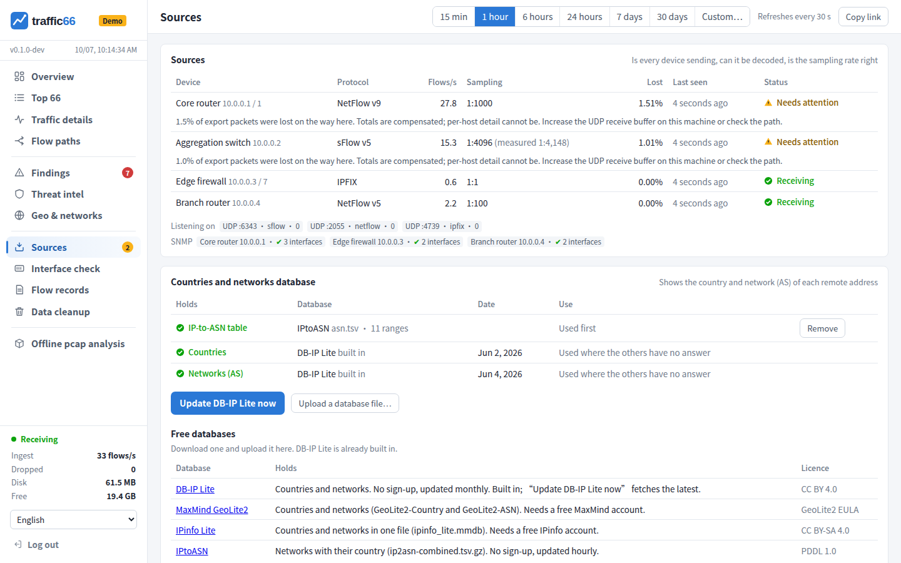
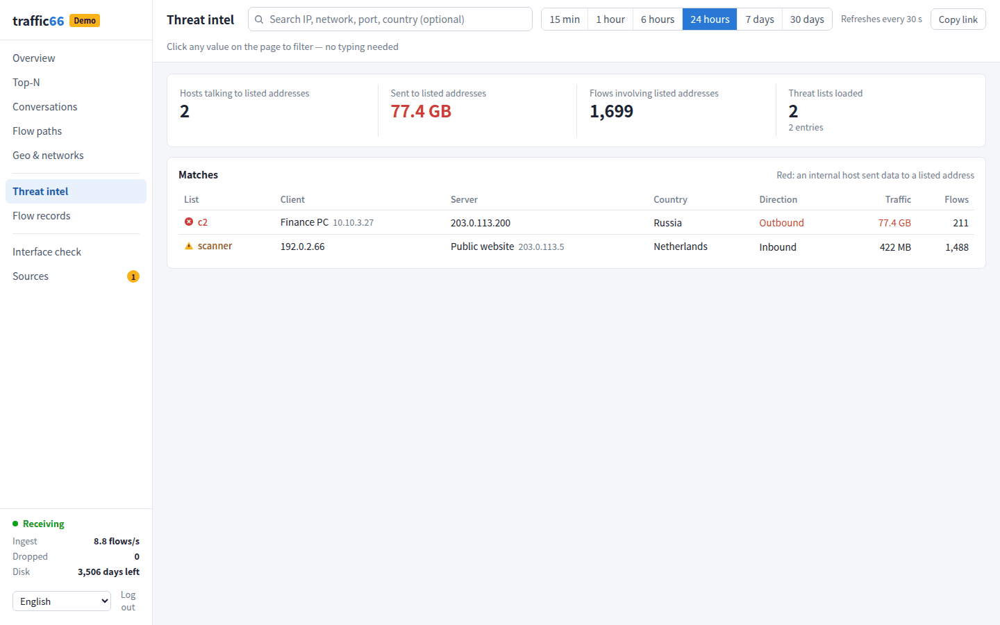
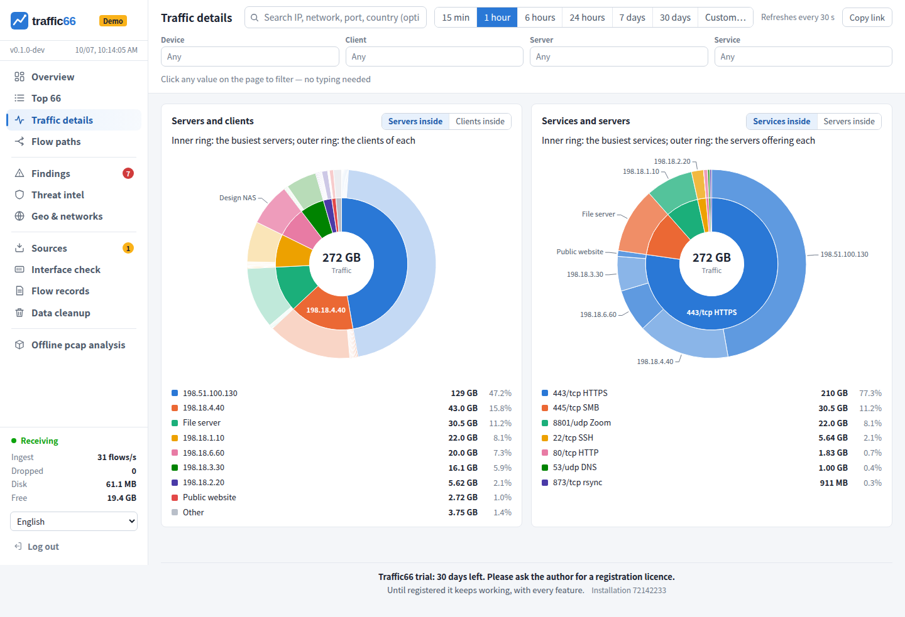
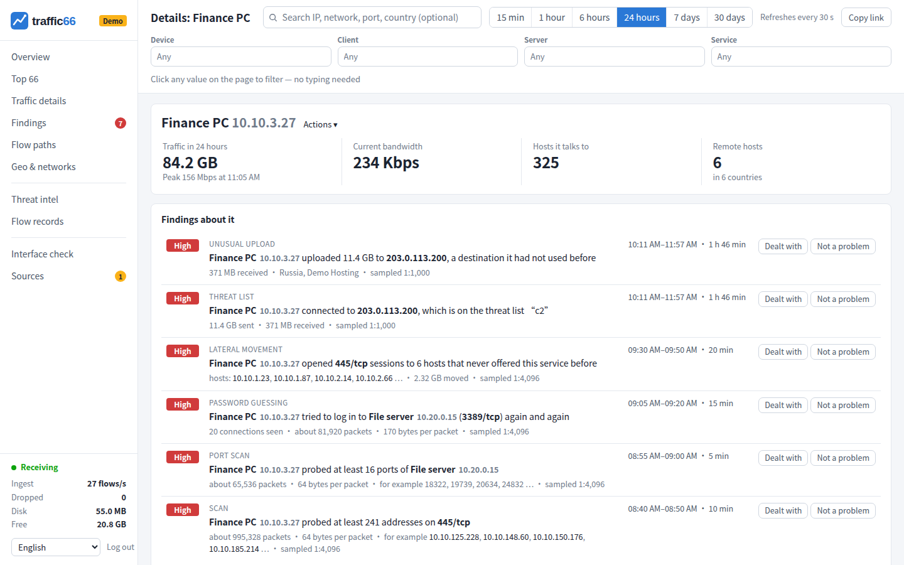
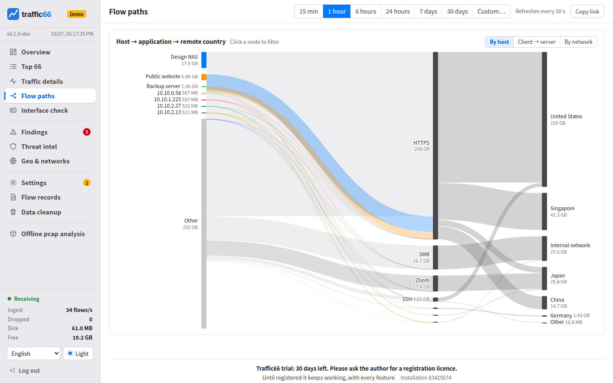
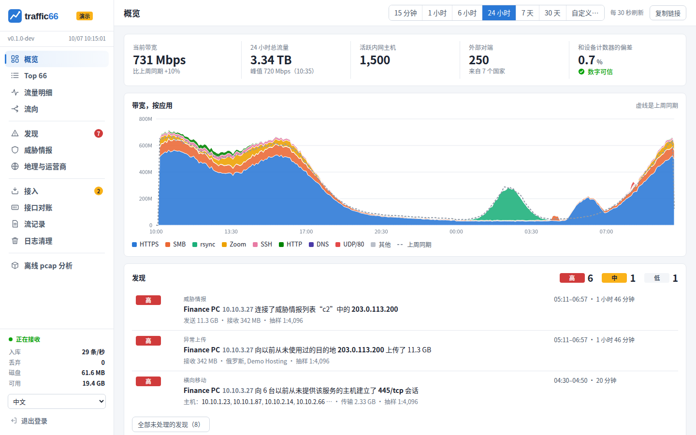
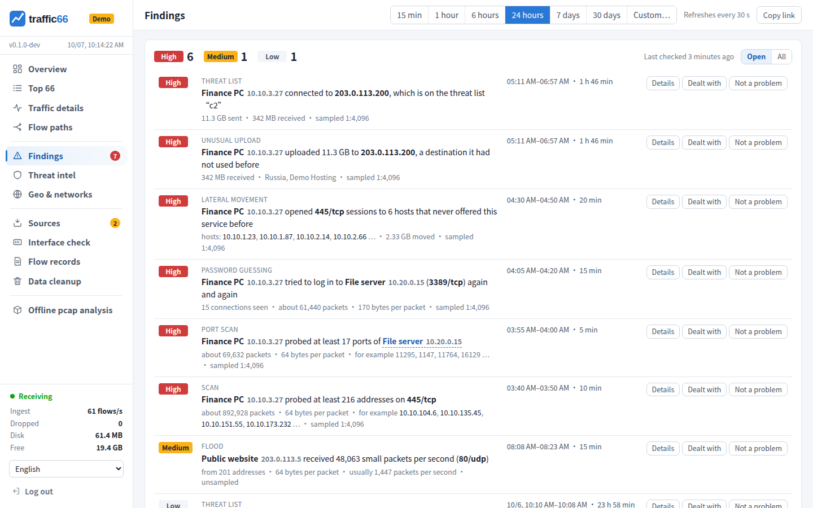
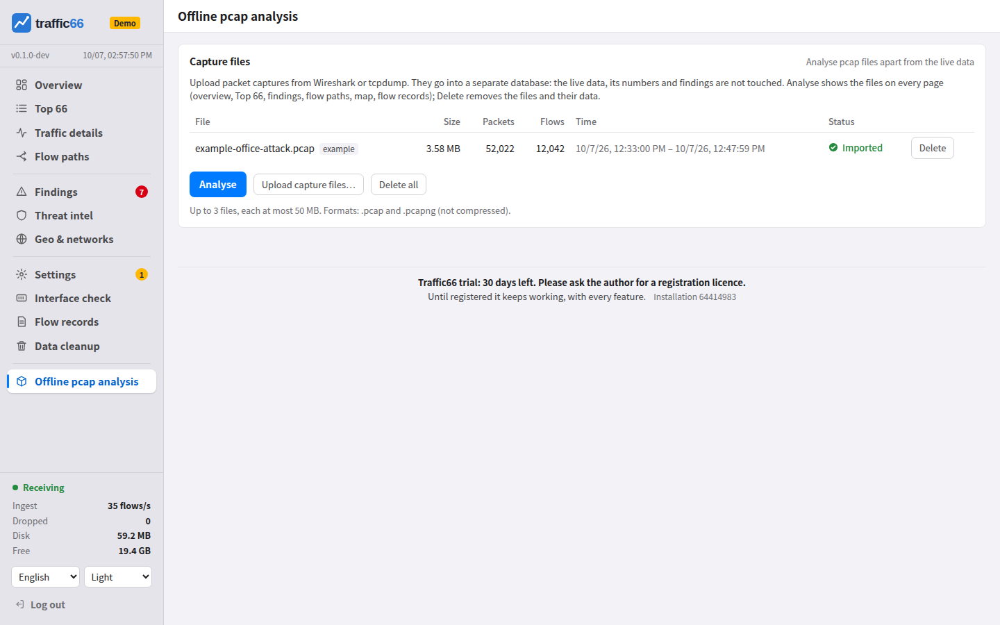
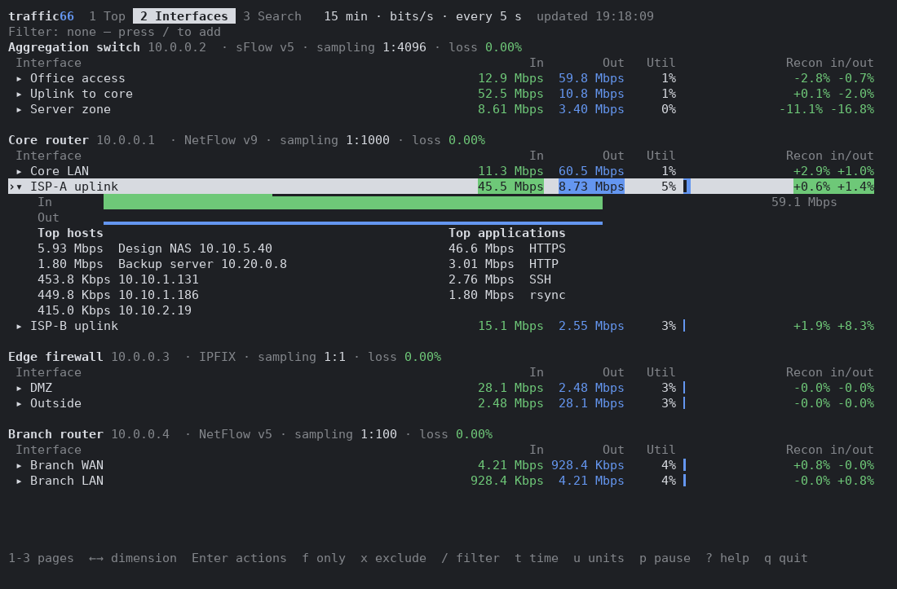

[English](MANUAL.md) | [中文](MANUAL.zh.md) | [हिन्दी](MANUAL.hi.md) | [Español](MANUAL.es.md) | [العربية](MANUAL.ar.md) | [Français](MANUAL.fr.md) | [বাংলা](MANUAL.bn.md) | [Português](MANUAL.pt.md) | [Русский](MANUAL.ru.md) | [Bahasa Indonesia](MANUAL.id.md) | **اردو** | [Deutsch](MANUAL.de.md) | [日本語](MANUAL.ja.md) | [Tiếng Việt](MANUAL.vi.md) | [한국어](MANUAL.ko.md)

<div dir="rtl">

# traffic66 — NetFlow، sFlow اور IPFIX کلیکٹر اور ٹریفک اینالائزر

sFlow، NetFlow اور IPFIX کے لیے flow analytics، ایک ہی پروگرام میں: bandwidth
کون استعمال کر رہا ہے، ٹریفک کہاں جا رہی ہے، اور کیا اعداد ڈیوائسز کے اپنے
interface counters سے میل کھاتے ہیں — web UI اور terminal UI میں۔

ntopng، ElastiFlow، Grafana کے ساتھ pmacct، یا PRTG اور SolarWinds NTA کے
flow modules کا self-hosted متبادل — نیٹ ورک مانیٹرنگ (network monitoring)،
bandwidth مانیٹرنگ (bandwidth monitoring)، سب سے زیادہ ٹریفک والے hosts
(top talkers)، DDoS اور scan کی نشاندہی، اور pcap تجزیے کے لیے، بغیر
Elasticsearch، Kafka یا الگ database کے۔

- Windows، Linux اور macOS کے لیے ایک ہی executable؛ کوئی database انسٹال نہیں کرنا، offline بھی چلتا ہے۔
- کسی بھی UDP port پر sFlow v5، NetFlow v5/v9 اور IPFIX، یا کسی interface سے local capture۔
- اپنے اعداد کو interface counters (sFlow یا SNMP) سے ملا کر جانچتا ہے اور بتاتا ہے کہ فرق کیوں ہے۔
- scans، پاس ورڈ کا اندازہ، lateral movement، غیر معمولی uploads، floods اور threat list والی ٹریفک ڈھونڈتا ہے، sampling کے باوجود بھی۔
- `traffic66 capture.pcap` بغیر کسی سیٹ اپ کے پیکٹ کیپچر کا تجزیہ کرتا ہے۔
- 15 زبانیں۔ جانچ کے لیے اور 100 سے کم افراد والی تنظیموں کے لیے مفت ([لائسنس](#licence))۔


<sub>تمام اسکرین شاٹس `traffic66 demo` سے لیے گئے ہیں، ایک simulated کمپنی نیٹ ورک۔</sub>

<a id="contents"></a>

## فہرست

1. [فوری آغاز](#1-quick-start)
2. [مثالیں](#2-examples)
3. [یوزرز اور پاس ورڈ](#3-users-and-passwords)
4. [اپنی ڈیوائسز سے flows بھیجیں](#4-send-flows-from-your-devices)
5. [جانچیں کہ flows پہنچ رہے ہیں](#5-check-that-flows-arrive)
6. [Interfaces اور counters](#6-interfaces-and-counters)
7. [نام، ممالک اور threat lists](#7-names-countries-and-threat-lists)
8. [web UI کا استعمال](#8-using-the-web-ui)
9. [آف لائن pcap، terminal UI، local capture](#9-offline-pcap-terminal-ui-local-capture)
10. [آپشنز اور ڈیٹا](#10-options-and-data)
11. [سکیورٹی، گنجائش کا اندازہ، مسائل کا حل](#11-security-sizing-troubleshooting)
12. [انسٹال، اپ گریڈ، ریورس پراکسی، نگرانی](#12-install-upgrade-reverse-proxy-monitoring)

<a id="1-quick-start"></a>

<a id="1-try-the-demo"></a>

## 1. فوری آغاز

1. اپنے سسٹم کا آرکائیو ڈاؤن لوڈ کریں: [Releases](https://github.com/githubflyideas/traffic66/releases/latest): `traffic66-linux-amd64.tar.gz`, `traffic66-linux-arm64.tar.gz`, `traffic66-darwin-arm64.tar.gz`, `traffic66-darwin-amd64.tar.gz`, `traffic66-windows-amd64.zip`.
2. کھول کر پروگرام چلائیں:

```
tar xzf traffic66-linux-amd64.tar.gz
cd traffic66-linux-amd64
./traffic66
```

Windows: `traffic66-windows-amd64.zip` کھولیں اور `traffic66.exe` چلائیں (ڈبل کلک بھی کافی ہے)۔

macOS: پہلے اس فولڈر میں `xattr -dr com.apple.quarantine .` چلائیں۔

پھر:

- ویب UI: `http://<سرور IP>:8066`۔ یہ تمام نیٹ ورک انٹرفیسز پر سنتا ہے۔
- سائن اِن: صارف `admin`، پاس ورڈ `traffic66`۔ پہلی بار سائن اِن پر نیا پاس ورڈ رکھنا ہوتا ہے۔
- آلات کو سرور IP پر بھیجنے دیں: sFlow UDP 6343، NetFlow v5/v9 UDP 2055، IPFIX UDP 4739 (تمام انٹرفیسز؛ ہر پورٹ ہر پروٹوکول لیتا ہے)۔

<a id="2-examples"></a>

<a id="2-install"></a>

## 2. مثالیں

<a id="command-cheat-sheet"></a>

### کمانڈز کا خلاصہ

| کام | کمانڈ |
|---|---|
| sFlow 6343، NetFlow v5/v9 2055، IPFIX 4739 جمع کریں (ڈیفالٹ) | `./traffic66` |
| صرف sFlow، UDP 6343 | `./traffic66 -listen sflow=:6343` |
| صرف NetFlow v5/v9 (2055) اور IPFIX (4739) | `./traffic66 -listen netflow=:2055,ipfix=:4739` |
| دوسرے UDP پورٹس | `./traffic66 -listen netflow=:9995,sflow=:6344` |
| کلیکٹرز ایک IP پر | `./traffic66 -listen sflow=10.0.0.5:6343,netflow=10.0.0.5:2055,ipfix=10.0.0.5:4739` |
| ویب UI مخصوص IP اور پورٹ پر | `./traffic66 -addr 10.0.0.5:8080` |
| ویب UI صرف اسی مشین پر | `./traffic66 -addr 127.0.0.1:8066` |
| ویب UI بذریعہ HTTPS | `./traffic66 -tls` |
| ڈیٹا ڈائریکٹری | `./traffic66 -data /var/lib/traffic66` |
| flow تفصیل 7 دن رکھیں | `./traffic66 -retention-days 7` |
| میموری: ڈیٹابیس کے لیے RAM کا 20% | `./traffic66 -memory 0.20` |
| لوکل کیپچر کے لیے نیٹ ورک کارڈز کی فہرست | `./traffic66 interfaces` |
| اس مشین کا NIC کیپچر کریں (Linux) | `sudo ./traffic66 -capture eth0 -listen ""` |
| اس مشین کا NIC کیپچر کریں (macOS) | `sudo ./traffic66 -capture en0 -listen ""` |
| اس مشین کا NIC کیپچر کریں (Windows، Npcap درکار) | `.\traffic66.exe -capture Wi-Fi -listen ""` |
| admin پاس ورڈ سیٹ/ری سیٹ کریں (‎-data DIR ہو تو شامل کریں) | `./traffic66 passwd` |
| admin کا بے ترتیب پاس ورڈ سیٹ کر کے دکھائیں | `./traffic66 passwd -generate` |
| صارف شامل کریں یا پاس ورڈ بدلیں | `./traffic66 passwd -user alice` |
| صارفین کی فہرست | `./traffic66 passwd -list` |
| صرف اس رن کا پاس ورڈ (اسکرپٹس، کنٹینرز) | `TRAFFIC66_PASSWORD='S3cret-pass' ./traffic66` |
| traffic66 مشین پر ٹرمینل UI | `./traffic66 tui` |
| ریموٹ سرور سے ٹرمینل UI | `./traffic66 tui -server http://192.0.2.50:8066 -user admin -password 'S3cret-pass'` |
| ٹرمینل UI کی زبان | `./traffic66 tui -lang ja` |
| کیپچر فائل کا تجزیہ | `./traffic66 capture.pcap` |
| کلیکٹر کو آزمائشی flows بھیجیں | `./traffic66 simulate -to 192.0.2.50` |
| فرضی آلات کے ساتھ ڈیمو | `./traffic66 demo` |
| تمام اختیارات | `./traffic66 serve -h` |

ویب UI کی زبان: مینو کے نیچے (کوئی فلیگ نہیں)۔ باقی: `traffic66 serve -h`۔

<a id="device-configuration"></a>

### آلات کی ترتیب

`192.0.2.50` traffic66 ہے، `192.0.2.1` آلہ؛ ٹائم آؤٹ اور سیمپلنگ ریٹ: [حصہ 4](#4-send-flows-from-your-devices)۔

```
! Cisco IOS-XE, NetFlow v9 (IPFIX: add "export-protocol ipfix" and use "transport udp 4739")
flow exporter T66
 destination 192.0.2.50
 transport udp 2055
 option sampler-table
flow monitor T66
 exporter T66
 record netflow ipv4 original-input
 cache timeout active 60
interface GigabitEthernet0/0/0
 ip flow monitor T66 input
```

```
# Huawei CloudEngine, sFlow
sflow agent ip 192.0.2.1
sflow collector 1 ip 192.0.2.50
interface 10GE1/0/1
 sflow sampling collector 1
 sflow sampling rate 4096
 sflow sampling inbound
 sflow counter collector 1
 sflow counter interval 30
```

```
# Huawei AR/NE, NetStream (NetFlow v9)
ip netstream export version 9
ip netstream export host 192.0.2.50 2055
ip netstream timeout active 1
interface GigabitEthernet0/0/1
 ip netstream inbound
 ip netstream sampler fix-packets 1000 inbound
```

```
# H3C Comware 7, sFlow
sflow agent ip 192.0.2.1
sflow collector 1 ip 192.0.2.50
interface Ten-GigabitEthernet1/0/1
 sflow sampling-rate 4096
 sflow flow collector 1
 sflow counter interval 30
 sflow counter collector 1
```

```
# Juniper EX/QFX, sFlow
set protocols sflow collector 192.0.2.50 udp-port 6343
set protocols sflow sample-rate ingress 4096
set protocols sflow interfaces ge-0/0/0

# Arista EOS, sFlow
sflow sample 4096
sflow destination 192.0.2.50
sflow run
```

```
# MikroTik RouterOS 7, NetFlow v9 (IPFIX: version=ipfix port=4739)
/ip traffic-flow set enabled=yes interfaces=all active-flow-timeout=1m
/ip traffic-flow target add dst-address=192.0.2.50 port=2055 version=9

# Linux host, softflowd
softflowd -i eth0 -n 192.0.2.50:2055 -v 9 -t maxlife=60
```

### فائر وال کھولیں

```
sudo firewall-cmd --permanent --add-port={6343,2055,4739}/udp --add-port=8066/tcp && sudo firewall-cmd --reload   # RHEL, Fedora
sudo ufw allow proto udp to any port 6343,2055,4739 && sudo ufw allow 8066/tcp                          # Ubuntu, Debian
New-NetFirewallRule -DisplayName traffic66 -Direction Inbound -Protocol UDP -LocalPort 6343,2055,4739 -Action Allow   # Windows
New-NetFirewallRule -DisplayName traffic66-web -Direction Inbound -Protocol TCP -LocalPort 8066 -Action Allow
```

### ویب UI صرف اسی مشین پر، SSH کے ذریعے

```
./traffic66 -addr 127.0.0.1:8066                 # on the server
ssh -L 8066:127.0.0.1:8066 user@192.0.2.50        # on your PC, then open http://127.0.0.1:8066
```

### سروس کے طور پر: Linux (systemd)

```
sudo mkdir -p /opt/traffic66 && curl -fsSL https://github.com/githubflyideas/traffic66/releases/latest/download/traffic66-linux-amd64.tar.gz | sudo tar xz -C /opt/traffic66 --strip-components=1
sudo useradd --system --no-create-home --shell /usr/sbin/nologin traffic66
sudo install -d -o traffic66 -g traffic66 /var/lib/traffic66
sudo -u traffic66 /opt/traffic66/traffic66 passwd -data /var/lib/traffic66
```

`/etc/systemd/system/traffic66.service`:

```
[Unit]
Description=traffic66 flow analytics
After=network-online.target

[Service]
User=traffic66
ExecStart=/opt/traffic66/traffic66 -data /var/lib/traffic66
Restart=on-failure
MemoryMax=2G
#AmbientCapabilities=CAP_NET_RAW CAP_NET_ADMIN   # only for local capture

[Install]
WantedBy=multi-user.target
```

```
echo 'net.core.rmem_max=16777216' | sudo tee /etc/sysctl.d/90-traffic66.conf && sudo sysctl --system
sudo systemctl daemon-reload && sudo systemctl enable --now traffic66
journalctl -u traffic66 -f
```

### سروس کے طور پر: Windows

```
$a = New-ScheduledTaskAction -Execute 'C:\traffic66\traffic66.exe' -Argument '-data C:\traffic66\traffic66-data'
$s = New-ScheduledTaskSettingsSet -ExecutionTimeLimit ([TimeSpan]::Zero) -RestartCount 999 -RestartInterval (New-TimeSpan -Minutes 1)
Register-ScheduledTask -TaskName traffic66 -Action $a -Trigger (New-ScheduledTaskTrigger -AtStartup) -Settings $s -User 'NT AUTHORITY\SYSTEM' -RunLevel Highest
Start-ScheduledTask -TaskName traffic66
```

### سروس کے طور پر: macOS

`/usr/local/traffic66` میں کھولیں، quarantine فلیگ ہٹائیں، `traffic66 passwd -data "/Library/Application Support/traffic66"` چلائیں، اور ایسے LaunchDaemon سے شروع کریں جس کے `ProgramArguments` پروگرام، `-data` اور وہ ڈائریکٹری ہوں، `RunAtLoad` اور `KeepAlive` کے ساتھ۔

<a id="3-users-and-passwords"></a>

## 3. یوزرز اور پاس ورڈ

نئی installation میں `admin` / `traffic66` سے سائن اِن ہوتا ہے، اور پہلا سائن اِن
کچھ اور دکھانے سے پہلے نیا پاس ورڈ مانگتا ہے (demo `traffic66` ہی رکھتا ہے)۔ اس
کے بعد menu کے نیچے **اکاؤنٹ** میں آپ اپنا پاس ورڈ بدلتے ہیں؛ administrator
(`admin`) وہیں یوزرز شامل اور حذف بھی کرتا ہے اور ان کے پاس ورڈ reset کرتا ہے۔
LDAP / Active Directory سے سائن اِن زیرِ تیاری ہے۔

یوزرز data directory میں `password` کے اندر salted hashes کی صورت میں رکھے جاتے
ہیں۔ یہی کام traffic66 مشین پر ایک command سے بھی کیا جا سکتا ہے (اگر traffic66
`-data …` کے ساتھ چلتا ہے تو وہ بھی شامل کریں):

| کام | Command |
|---|---|
| `admin` کا پاس ورڈ بدلنا | `traffic66 passwd` |
| `alice` کو شامل کرنا یا اس کا پاس ورڈ بدلنا | `traffic66 passwd -user alice` |
| `alice` کو حذف کرنا | `traffic66 passwd -user alice -delete` |
| یوزرز کی فہرست | `traffic66 passwd -list` |

تبدیلیاں فوراً لاگو ہوتی ہیں۔ یوزرز کے انتظام کے علاوہ تمام یوزرز کے اختیارات
یکساں ہیں۔ scripts اور containers کے لیے `TRAFFIC66_PASSWORD=…` (یا `-password`) اس run میں صرف اسی
پاس ورڈ کے ساتھ `-user` کو قبول کرتا ہے۔ ایک منٹ میں پانچ غلط پاس ورڈ اس address
کو ایک منٹ کے لیے block کر دیتے ہیں۔

<a id="4-send-flows-from-your-devices"></a>

## 4. اپنی ڈیوائسز سے flows بھیجیں

`192.0.2.50` traffic66 ہے، `192.0.2.1` ڈیوائس۔ active timeout کو 60 سیکنڈ پر
رکھیں، NetFlow/IPFIX ڈیوائسز کو اپنے sampler options export کرنے دیں، اور
**ہر interface کو inbound** sample کریں (یا صرف edge interfaces): اس طرح ہر
packet ایک ہی بار گنا جاتا ہے۔ sFlow rates: 1 Gb/s کے لیے تقریباً 1:1000،
10 Gb/s کے لیے 1:4096، 40/100 Gb/s کے لیے 1:8192۔

Cisco، Huawei، H3C، Juniper، Arista، MikroTik اور softflowd کی ترتیب: [مثالیں ← آلات کی ترتیب](#device-configuration)۔

<a id="5-check-that-flows-arrive"></a>

## 5. جانچیں کہ flows پہنچ رہے ہیں

**ترتیبات** ہر اس ڈیوائس کو چند سیکنڈ میں دکھاتی ہیں جو کچھ بھی بھیجتی ہے:
protocol، sampling rate، loss، وہ interfaces جنہیں وہ sample کرتی ہے، اور status
سبز نہ ہو تو کیا ٹھیک کرنا ہے۔ sFlow کا loss دو حصوں میں بٹا ہوتا ہے: راستے میں
ضائع (اگر `netstat -su` buffer errors دکھائے تو `net.core.rmem_max` بڑھائیں)
اور وہ samples جو ڈیوائس نے خود گرا دیے۔

شروع کرنے کے فوراً بعد تھوڑا انتظار معمول ہے: چارٹ تقریباً ایک منٹ پیچھے رہتے ہیں، NetFlow v9/IPFIX ڈیٹا ڈیوائس کے ٹیمپلیٹ کا انتظار کرتا ہے، اور جس ڈیوائس نے ابھی سیمپلنگ ریٹ نہیں بھیجا اس کے ریکارڈ زیادہ سے زیادہ 5 منٹ (`-sampling-wait`) روکے جاتے ہیں، پھر 1:1 شمار ہو کر یہاں نشان زد ہوتے ہیں۔



کوئی ڈیوائس غائب ہے؟ `sudo tcpdump -ni any udp port 6343 or udp port 2055
or udp port 4739` چلائیں: وہاں کچھ نہ ہو تو مسئلہ routing، کسی firewall یا
ڈیوائس کی configuration میں ہے؛ packets وہاں ہوں مگر **ترتیبات** میں کچھ نہ ہو
تو local firewall یا `-listen`۔ کسی دوسری مشین سے
`traffic66 simulate -to 192.0.2.50` simulated ڈیوائسز کے ساتھ راستہ جانچتا ہے۔

<a id="6-interfaces-and-counters"></a>

## 6. Interfaces اور counters

Flow کے اعداد اندازے ہیں (samples × sampling rate)۔ **انٹرفیس جانچ** انہیں
ڈیوائس کے interface counters سے ملاتی ہے (sFlow counters، یا نام میں `snmp`
لائن کے ذریعے SNMP) اور بتاتی ہے کہ فرق کیوں ہے: interfaces sample نہیں ہو رہے،
ایک ہی ٹریفک دو بار sample ہوئی، راستے میں loss، یا sampling rate نامعلوم۔ ہر
interface کا ایک bits/s اور ایک packets/s chart ہے، ingress سبز اور egress
نیلا، counters ڈیشڈ لکیروں میں۔

ہر row پر **✎** ایک نام اور ایک مختصر ٹیگ (جیسے *uplink*) دیتا ہے اور **☆** اسے
ڈیفالٹ interface (★) بناتا ہے، جس پر صفحات کھلتے ہیں۔

جو ڈیوائس صرف کچھ interfaces sample کرتی ہے وہ ان flows کے دوسرے سرے بھی دکھاتی
ہے۔ یہ **مخالف سرے کے انٹرفیس** آخر میں چھوٹے سرمئی حروف میں دکھائے جاتے ہیں: ان
میں صرف وہ ٹریفک ہوتی ہے جو سیمپل والے interface سے گزری۔ سیمپل والا interface
sFlow کے data source یا flowDirection field (IPFIX 61) سے معلوم ہوتا ہے؛ اس کے
بغیر، وہ interface جو ڈیوائس کی 90% ٹریفک میں ہو۔


traffic66 پہلے ہی وہ rate استعمال کرتا ہے جو ڈیوائس نے لاگو کیا، نامعلوم rates کا
انتظار کرتا ہے، export loss کی تلافی کرتا ہے، لمبے flows کو ان کے منٹوں پر بانٹتا
ہے اور NetFlow/IPFIX میں ہر packet پر 18 bytes کا Ethernet overhead جوڑتا ہے
(`-l2-overhead`)۔

<a id="7-names-countries-and-threat-lists"></a>

## 7. نام، ممالک اور threat lists

کسی بھی address پر کلک کر کے **نام دیں…** چنیں، یا **رجسٹر** استعمال
کریں۔ نام data directory میں `inventory.txt` میں رکھے جاتے ہیں:

```
net    10.10.0.0/16    Office LAN                  # your networks
net    203.0.113.0/24  Public servers country=JP    # country: lines on the world map
device 192.0.2.1       Core router
device 192.0.2.9       Branch firewall unsampled    # exports every packet
device 192.0.2.20      Edge router sampling=1000    # rate it does not declare
iface  192.0.2.1 3     ISP uplink speed=1000000000 tag=uplink default
host   10.10.3.27      Finance PC
snmp   192.0.2.1       public                       # read counters over SNMPv2c
snmp   192.0.2.9       s3cret  10.99.0.9:161        # other management address
```

private ranges ہمیشہ آپ کی ہوتی ہیں۔ تبدیلیاں **محفوظ کریں** پر لاگو ہوتی ہیں،
restart کی ضرورت نہیں۔

ممالک اور نیٹ ورکس (AS) شروع سے DB-IP کے مفت Lite ڈیٹابیس کے ساتھ کام کرتے ہیں
([CC BY 4.0](https://creativecommons.org/licenses/by/4.0/)، "IP
Geolocation by DB-IP"، [db-ip.com](https://db-ip.com))؛ **ترتیبات** انہیں اپ
ڈیٹ کرتی ہیں، یا ان کی جگہ MaxMind GeoLite2، IPinfo Lite یا IPtoASN فائلیں لیتی
ہیں۔ نقشے کی سرحدیں: [Natural Earth](https://www.naturalearthdata.com)۔


Threat lists متن کی فائلیں ہیں، ہر لائن میں ایک address یا نیٹ ورک،
`<data>/threats/<name>.txt` میں (مثلاً Spamhaus DROP)؛ انہیں بدلنے کے بعد restart
کریں۔ matches **خطرے کی معلومات** پر نظر آتے ہیں۔



<a id="8-using-the-web-ui"></a>

## 8. web UI کا استعمال

ہر صفحے کی ہر value پر کلک کیا جا سکتا ہے: **صرف یہ دکھائیں** / **اسے خارج
کریں** (filters ہر صفحے پر لاگو ہوتے ہیں)، **اس کے فلو ریکارڈ دکھائیں**،
**تفصیل دیکھیں** (ایک host یا service کے بارے میں صفحہ)، **نام دیں…**، **آن
لائن معلوم کریں**، **کاپی کریں**۔

| صفحہ | کیا دکھاتا ہے |
|---|---|
| جائزہ | منتخب interface کی bandwidth؛ کل یا پچھلے ہفتے کے مقابلے میں application کے حساب سے ٹریفک (کل، اندر آنے والی یا باہر جانے والی)؛ کھلی مشتبہ سرگرمیاں؛ سرفہرست clients اور services |
| ٹاپ 66 | سرفہرست 66 conversations، کسی بھی column سے sort ہونے والی، یا application، نیٹ ورک، segment، ڈیوائس، encapsulation، VLAN کے لحاظ سے گروپ؛ سب سے فعال 33 hosts |
| ٹریفک کی تفصیل | Ring charts: servers اور ان کے clients (یا الٹا)، اور services |
| ٹریفک کے راستے | host ← application ← ملک، یا client ← service ← server، یا نیٹ ورک کے لحاظ سے |
| انٹرفیس جانچ | وقت کے ساتھ ہر interface اپنے counters کے مقابلے میں؛ نام، ٹیگ، ڈیفالٹ |
| فلو ریکارڈ | انفرادی flows، ہر 5 سیکنڈ میں لائیو یا کسی بھی وقت کی حد کے لیے |
| مشتبہ سرگرمی، خطرے کی معلومات | کس چیز پر توجہ چاہیے ([نیچے](#findings))؛ فہرست والے addresses کے ساتھ ٹریفک |
| مقامات اور نیٹ ورک | ملک کے لحاظ سے دنیا کا نقشہ، وقت کے ساتھ نیٹ ورکس (AS) |
| ترتیبات | ڈیوائسز، sampling، loss، SNMP، ڈیٹابیس، لوگو، نام |
| آف لائن pcap تجزیہ، ڈیٹا کی صفائی | کیپچر فائلیں ([نیچے](#9-offline-pcap-terminal-ui-local-capture))؛ پرانا ڈیٹا حذف کرنا |

صفحات کے اوپر: **انٹرفیس** (سب، یا ایک سیمپل والا interface؛ تب ٹریفک کے صفحات
صرف اس سے گزرنے والی ٹریفک دکھاتے ہیں)، وقت کی حد (15 منٹ سے 30 دن، یا اپنی
مرضی)، ہر 30 s پر refresh اور بالکل موجودہ view کے لیے **لنک کاپی کریں**۔ زبان
اور رنگوں کی پانچ تھیمیں menu کے نیچے ہیں۔ Charts وہاں ختم ہوتے ہیں جہاں ڈیٹا
مکمل ہو: NetFlow/IPFIX کے ساتھ اتنی دیر پہلے جتنی دیر سے ڈیوائسز export کرتی
ہیں (زیادہ سے زیادہ 2 منٹ)۔ 6 گھنٹے سے لمبی حدیں پورے گھنٹے سے شروع ہوتی ہیں؛
7 یا 30 دن کے لیے ایک interface flow detail پڑھتا ہے، اس لیے سست ہوتا ہے اور
صرف اتنا پیچھے جاتا ہے جتنی دیر detail رکھی جاتی ہے۔










<a id="findings"></a>

### مشتبہ سرگرمی

ہر 5 منٹ پر پچھلے 10 منٹ جانچے جاتے ہیں؛ جو چیز ایک گھنٹہ چلے وہ ایک ہی اندراج
ہے جو بڑھتا رہتا ہے۔

| سرگرمی | اس کا مطلب |
|---|---|
| اسکین، پورٹ اسکین | ایک port پر بہت سے hosts کو، یا ایک host کے بہت سے ports کو چھوٹے probes |
| پاس ورڈ کا اندازہ | کسی login service سے بہت سے مختصر connections |
| لیٹرل موومنٹ | ایسے internal hosts سے file sharing یا remote administration جنہوں نے پہلے کبھی یہ پیش نہیں کیا |
| غیر معمولی اپ لوڈ | ایک نئے address کو 10 منٹ میں 100 MB، واپس آنے والے کا تین گنا |
| فلڈ | ایک address پر فی سیکنڈ 20,000+ چھوٹے packets، اس کی معمول کی رفتار کا دس گنا |
| خطرے کی فہرست | فہرست والے address کے ساتھ ٹریفک |

آپ کے نیٹ ورک کے اندر سے ہوں تو یہ زیادہ شدت کی ہوتی ہیں، انٹرنیٹ سے کم۔
**نمٹا دیا** اندراج بند کرتا ہے، **مسئلہ نہیں** اسے ہمیشہ کے لیے خاموش کر دیتا
ہے۔ لیٹرل موومنٹ اور اپ لوڈ کے لیے ایک دن کی تاریخ چاہیے۔ 1:4096 sampling کے
باوجود ڈیمو کا حملہ پورا پکڑا جاتا ہے؛ بہت چھوٹے scans sampling کے پیچھے چھپ
سکتے ہیں۔



<a id="9-offline-pcap-terminal-ui-local-capture"></a>

## 9. آف لائن pcap، terminal UI، local capture

**آف لائن pcap تجزیہ** پیکٹ کیپچر (pcap، pcapng) کو انہی صفحات پر دکھاتا ہے، لائیو
ڈیٹا سے الگ: `traffic66 a.pcap b.pcapng` 127.0.0.1 پر شروع ہوتا ہے اور browser
کھولتا ہے (زیادہ سے زیادہ 3 فائلیں، 3 GB؛ Ctrl+C امپورٹ شدہ ڈیٹا حذف کر دیتا
ہے)، یا اسی صفحے پر 50 MB تک کی 3 فائلیں اپ لوڈ کریں۔ ایک وقت میں ایک فائل کا
تجزیہ ہوتا ہے، ہر فائل اپنے الگ ڈیٹابیس میں: کسی فائل کی قطار پر
**تجزیہ کریں** اسے ہر صفحے پر دکھاتا ہے، اور اوپر کی پٹی دوسری فائل پر بدل دیتی
ہے۔ یہ flows پر کام کرتا ہے، پیکٹ کے مواد پر نہیں۔



**Terminal UI**: traffic66 مشین پر `traffic66 tui`، یا
`traffic66 tui -server http://192.0.2.50:8066 -user admin -password …`۔
تین صفحات: **1 ٹاپ** (کلائنٹ، سرور، ایپلیکیشنز، پورٹس، نیٹ ورکس (AS) اور ممالک/علاقے شرح کے لحاظ سے؛ ← → بدلیں، Enter اعمال)، **2 انٹرفیس** (ہر آلے اور انٹرفیس کی شرح، استعمال اور مطابقت، ساتھ ہر آلے کی سیمپلنگ اور نقصان؛ Enter رجحان اور سرفہرست ہوسٹ/ایپس کھولتا ہے) اور **3 تلاش** (`ip:10.0.0.5 net:10.0.0.0/8 asn:13335 port:443 cc:US dev:192.0.2.1` جیسے فلٹرز سے فلو ریکارڈ)۔ کلیدیں: `/` فلٹر، Backspace/`c` ہٹائیں/صاف، `t` وقت کی حد (5 منٹ سے 24 گھنٹے)، `u` بٹ/س، بائٹس یا پیکٹ/س، `p` روکیں، `+`/`-` ریفریش وقفہ، `w` وہی منظر براؤزر میں، `?` مدد، `q` باہر؛ `-lang` زبان چنتا ہے اور `NO_COLOR` رنگ بند کرتا ہے۔




**Local capture** ایک local interface سے flows بناتا ہے، بہترین ہے کہ وہ کسی
switch کے mirror port سے جڑا port ہو: `traffic66 interfaces` ان کی فہرست دیتا
ہے، `-capture eth1` capture کرتا ہے۔ Windows پر:

```
traffic66.exe interfaces          # list the network cards: name, number, address
traffic66.exe -capture Wi-Fi      # capture on the wireless card (or by number: -capture 2)
```

Linux کو root یا `setcap cap_net_raw,cap_net_admin+ep` چاہیے، macOS کو root،
Windows کو [Npcap](https://npcap.com)۔ capture شدہ flows ڈیوائس `127.0.0.1` سے
آتے ہیں۔ Local capture میں ڈیوائس کے interfaces یا counters نہیں ہوتے، اس لیے
**انٹرفیس جانچ** کے پاس اس کے لیے موازنہ کرنے کو کچھ نہیں ہے۔

<a id="sending-findings-to-a-collector"></a>

### نتائج کلیکٹر کو بھیجنا

رجسٹرڈ انسٹالیشن ہر نتیجہ پہلی بار نظر آتے ہی syslog کلیکٹر کو بھیج سکتی ہے:

```
traffic66 serve -syslog siem.example.com:514 -syslog-format cef
```

`-syslog-transport` `udp`، `tcp` یا `tls` ہے؛ `-syslog-min-sev` بھیجنے کے لائق کم سے کم شدت ہے؛ `-syslog-url https://traffic66.example.com` ہر پیغام میں نتیجے کا لنک ڈالتا ہے۔ `-syslog-ascii` ASCII سے باہر سب کچھ ایسکیپ کرتا ہے، ان کلیکٹرز کے لیے جو UTF-8 خراب کرتے ہیں۔

فارمیٹ چنا جا سکتا ہے، کیونکہ کیا خود بخود پارس ہوتا ہے یہ اس پر منحصر ہے کہ آپ پہلے سے کیا چلاتے ہیں:

| `-syslog-format` | بغیر پارسر لکھے پڑھتے ہیں |
|---|---|
| `cef` (ڈیفالٹ) | ArcSight، QRadar، Splunk، Graylog، Elastic، Wazuh |
| `leef` | QRadar، براہ راست |
| `json` | Elastic اور Splunk — نام Elastic Common Schema کے ہیں |
| `text` | ایک انسان |

ہر صورت میں بیرونی لفافہ RFC 5424 ہوتا ہے، اور اس میں نتیجے کی ID، اس کی قسم اور سیمپلنگ کی شرح ہوتی ہے، چاہے متن سادہ ہو۔

تین باتیں اس فیڈ کو صرف پڑھنے نہیں، گننے کے لائق بناتی ہیں۔ واقعے کی قسم (`scan`، `brute`، `exfil` …) ایک مستقل لفظ ہے جو الفاظ یا ترجمے کے ساتھ کبھی نہیں بدلتا، اس لیے اس سے گروپ کیا گیا ڈیش بورڈ کسی جملے کی بہتری پر نہیں ٹوٹتا۔ ایک نتیجہ ایک ID والا **ایک** واقعہ ہے، جو ہر جانچ پر نہیں بلکہ پہلی بار نظر آنے پر بھیجا جاتا ہے، اس لیے ایک رات کا پاس ورڈ اندازہ ایک واقعہ ہے، چالیس نہیں۔ اور سیمپلنگ کی شرح ہر پیغام کے ساتھ جاتی ہے: traffic66 سیمپل شدہ ڈیٹا پر پہچان کرتا ہے، اس لیے بائٹ اور پیکٹ کی گنتی اندازے ہیں، اور جو کلیکٹر یہ جانے بغیر انہیں جمع کرے وہ ایسا عدد بناتا ہے جس کا کوئی دفاع نہیں کر سکتا۔

<a id="10-options-and-data"></a>

## 10. آپشنز اور ڈیٹا

`traffic66 -h` سب کچھ دکھاتا ہے۔ سب سے زیادہ استعمال ہونے والے:

| آپشن | ڈیفالٹ | |
|---|---|---|
| `-data` | پروگرام کے ساتھ `traffic66-data` | data directory |
| `-addr` | `:8066` | web UI؛ صرف اس مشین کے لیے `127.0.0.1:8066` |
| `-listen` | `sflow=:6343,netflow=:2055,ipfix=:4739` | UDP collectors؛ خالی ہو تو بند |
| `-retention-days` | `30` | flow detail کے دن؛ summaries 400 دن رکھی جاتی ہیں |
| `-memory` | `0.10` | database cache کے لیے RAM کا حصہ |
| `-sampling-wait` | `5m` | records کتنی دیر sampling rate کا انتظار کریں |
| `-capture` | | local interface (بار بار دیا جا سکتا ہے) |
| `-no-dns` | | کوئی reverse lookup نہیں |

data directory میں `raw/` (detail، ہر گھنٹے کی ایک فائل)، `traffic66.duckdb`
(summaries اور counters)، `password`، `inventory.txt`، `license.json`، آپ کا
لوگو اور ڈیٹابیس ہوتے ہیں۔ بیک اپ کے لیے traffic66 روک کر اسے کاپی کریں؛ اپ گریڈ
کے لیے پروگرام فائل بدل دیں۔ **ڈیٹا کی صفائی** 7–120 دن سے پرانا ڈیٹا، یا سارا
ڈیٹا حذف کرتی ہے۔

<a id="device-locations"></a>

### آلات کے مقامات

انوینٹری صفحے کا ایک ٹیب۔ فلو کہاں سے آتے ہیں اس کی تصویر: فلو بھیجنے والے ہر آلے کا کمرہ اور ریک، اور اس کے ہر پورٹ کا کیریئر اور سرکٹ ID جس سے وہ باہر جاتا ہے۔ آلات اور پورٹ فلو سے خود ظاہر ہوتے ہیں؛ Edit پر کلک کر کے ایک ہی فارم میں آلے کا کمرہ اور ریک اور ہر پورٹ کا کیریئر اور سرکٹ لکھیں۔ یہ ایک بار بھرا جاتا ہے اور ناموں کے ساتھ `inventory.txt` میں رکھا جاتا ہے (`device 192.0.2.1 Core router room=Room_1 rack=A03`، `iface 192.0.2.1 3 Uplink isp=China_Telecom circuit=SH-12345`؛ خالی جگہ `_` لکھی جاتی ہے)۔ اس میں کچھ تلاش نہیں کیا جاتا۔ سائن اِن کرنے والے سب دیکھتے ہیں؛ منتظم اسے بدلتا ہے۔

<a id="licence"></a>

### لائسنس

[PolyForm Noncommercial License 1.0.0](../LICENSE.md) اور
[Traffic66 Additional Use Grant](../ADDITIONAL-USE-GRANT.md) کے تحت source
available (انگریزی متن لازم ہے): جانچ کے لیے اور 100 سے کم افراد والی تنظیموں کے
لیے مفت؛ بڑی تنظیمیں 30 دن کے production استعمال کے بعد رجسٹر کرتی ہیں؛ بیچنے،
دوسروں کے لیے host کرنے یا مقابل مصنوعات کے لیے تجارتی لائسنس چاہیے۔ کچھ بھی کبھی
بند نہیں کیا جاتا۔ ہر صفحے کے نیچے 8 ہندسوں کا installation نمبر دکھتا ہے؛ اسے
مصنف کو بھیجیں، اور جو `license.json` واپس ملے اسے data directory میں رکھیں۔
رابطہ: <route66traffic66@gmail.com>۔

<a id="11-security-sizing-troubleshooting"></a>

## 11. سکیورٹی، گنجائش کا اندازہ، مسائل کا حل

ریورس پراکسی کے پیچھے، [ریورس پراکسی](#reverse-proxy) دیکھیں۔

web UI سادہ HTTP ہے: غیر بھروسہ مند نیٹ ورکس پر `-addr 127.0.0.1:8066` استعمال
کریں، کسی TLS proxy کے پیچھے (`caddy reverse-proxy --from
traffic66.example.com --to 127.0.0.1:8066`) یا SSH tunnel کے ذریعے۔ UDP ports
کی اجازت صرف اپنی ڈیوائسز سے دیں۔ SNMP communities سادہ متن (clear text) میں
رکھی جاتی ہیں؛ read-only communities استعمال کریں۔

2 cores پر 5,000 flows/s پر: detail کے ہر دن کے لیے تقریباً 12 GB disk (30 دن
کے لیے 360 GB)، ایک core کا چھٹا حصہ، 0.6–0.8 GB memory۔ لمبی حدوں کے overviews
0.2 s سے کم لیتے ہیں؛ تمام conversations کا 1 گھنٹے کا Top 66 تقریباً 9 s۔

| علامت | حل |
|---|---|
| "waiting for the sampling rate" | sampler options export کریں، یا device لائن میں `sampling=N` / `unsampled` |
| counters سے کم | interfaces sample نہیں ہو رہے، loss، یا active timeout 60 s سے زیادہ |
| counters سے زیادہ | ایک ہی ٹریفک دو interfaces یا ڈیوائسز پر sample ہو رہی ہے |
| پاس ورڈ بھول گئے | traffic66 مشین پر `traffic66 passwd` |
| `Conflicting lock is held` | کوئی دوسرا traffic66 یہ data directory استعمال کر رہا ہے |
| `address already in use` | `-addr` یا `-listen` سے دوسرے ports چنیں |
| Windows "protected your PC" | **More info** (مزید معلومات) → **Run anyway** (پھر بھی چلائیں) |

سورس سے بِلڈ: Go 1.26 اور ایک C compiler، پھر `CGO_ENABLED=1 go build ./cmd/traffic66`۔

</div>

<a id="12-install-upgrade-reverse-proxy-monitoring"></a>

## 12. انسٹال، اپ گریڈ، ریورس پراکسی، نگرانی

ڈاؤن لوڈ کی جانچ، ڈیٹا کھوئے بغیر اپ گریڈ، traffic66 کو nginx، Caddy یا Traefik کے پیچھے رکھنا، اور Prometheus سے اس کی نگرانی کا طریقہ۔

<a id="verify-a-download"></a>

### ڈاؤن لوڈ کی جانچ

ہر ریلیز کے ساتھ ایک `SHA256SUMS` فائل، شامل سافٹ ویئر کی فہرست (`traffic66-sbom.cdx.json`، CycloneDX) اور GitHub Actions کا بِلڈ ماخذ ثبوت آتا ہے، جو ثابت کرتا ہے کہ آرکائیو اسی ریپوزٹری کے سورس سے بنا ہے۔ ڈاؤن لوڈ والے فولڈر میں:

```
sha256sum -c SHA256SUMS --ignore-missing          # Linux
shasum -a 256 -c SHA256SUMS --ignore-missing      # macOS
gh attestation verify traffic66-linux-amd64.tar.gz -R githubflyideas/traffic66
```

Windows (PowerShell): `Get-FileHash traffic66-windows-amd64.zip` ہیش دکھاتا ہے؛ یہ `SHA256SUMS` میں اس فائل کی سطر کے برابر ہونا چاہیے۔ `gh attestation verify` کے لیے GitHub CLI درکار ہے اور یہ اختیاری ہے۔

<a id="upgrade-and-roll-back"></a>

### اپ گریڈ اور واپسی

traffic66 روکیں، پوری ڈیٹا ڈائریکٹری کاپی کریں، پروگرام فائل بدلیں اور دوبارہ شروع کریں۔ Linux سروس کے طور پر:

```
systemctl stop traffic66
cp -a /opt/traffic66/traffic66-data /opt/traffic66/traffic66-data.bak
tar xzf traffic66-linux-amd64.tar.gz && cp traffic66-linux-amd64/traffic66 /opt/traffic66/
systemctl start traffic66
```

واپس جانے کے لیے traffic66 روکیں اور پرانا پروگرام اور کاپی کی ہوئی ڈیٹا ڈائریکٹری واپس رکھیں۔ کوئی ورژن نئے فارمیٹ میں لکھے ڈیٹا کا اندازہ نہیں لگاتا: وہ رک کر بتاتا ہے کہ کس ورژن نے اسے لکھا۔ اسے کسی اور `-data` ڈائریکٹری کے ساتھ چلائیں، یا نئے ورژن پر واپس جائیں۔ اگر ڈیٹا آخری بار کسی اور ورژن نے لکھا تھا تو ہر شروعات لاگ میں لکھتی ہے۔

بجلی جانے یا `kill -9` کے بعد، اگلی شروعات فلو کی تفصیل سے پچھلے چند گھنٹوں کے خلاصے دوبارہ بناتی ہے، تاکہ 24 گھنٹے اور لمبے منظر میں کچھ کم نہ ہو، اور لاگ میں لکھتی ہے۔

<a id="reverse-proxy"></a>

### ریورس پراکسی

اگر صفحے کا پتہ اس پتے سے نہ ملے جو traffic66 دیکھتا ہے تو traffic66 سائن اِن اور تبدیلیاں رد کر دیتا ہے، تاکہ کوئی دوسری ویب سائٹ آپ کے نام سے کام نہ کر سکے۔ ریورس پراکسی کے پیچھے، پراکسی سے براؤزر کا ہوسٹ نام آگے بھجوائیں (`Host`، `X-Forwarded-Host` یا `Forwarded` ہیڈر)، یا traffic66 کو اس کا عوامی پتہ بتائیں:

```
traffic66 serve -addr 127.0.0.1:8066 -public-url https://traffic66.example.com
```

ڈیفالٹ پورٹ (https کے لیے `:443`، http کے لیے `:80`) لکھیں یا چھوڑ دیں، دونوں چلتا ہے۔ traffic66 کو اپنے ہوسٹ نام کی جڑ پر ہونا چاہیے، `/traffic66/` جیسے پاتھ کے نیچے نہیں۔ اس وجہ سے کوئی درخواست رد ہو تو سائن اِن صفحہ اور باقی صفحات "پاس ورڈ غلط" کے بجائے یہی وجہ بتاتے ہیں۔ ویب UI کو اسی مشین تک رکھیں (`-addr 127.0.0.1:8066`)، تاکہ اس تک صرف پراکسی سے پہنچا جا سکے۔

**nginx** (ڈیفالٹ `proxy_set_header Host $proxy_host;` اندرونی پتہ بھیجتا ہے، اس لیے اسے سیٹ کریں):

```
server {
    listen 443 ssl;
    server_name traffic66.example.com;
    ssl_certificate     /etc/ssl/traffic66.crt;
    ssl_certificate_key /etc/ssl/traffic66.key;
    client_max_body_size 200m;
    location / {
        proxy_pass http://127.0.0.1:8066;
        proxy_set_header Host $http_host;
        proxy_set_header X-Forwarded-Proto $scheme;
    }
}
```

**Caddy** ہوسٹ نام خود آگے بھیجتا ہے اور اس کے لیے سرٹیفکیٹ لیتا ہے:

```
traffic66.example.com {
    reverse_proxy 127.0.0.1:8066
}
```

**Traefik** ہوسٹ نام خود آگے بھیجتا ہے (`passHostHeader` ڈیفالٹ میں آن)؛ فائل پرووائیڈر کے لیے ڈائنامک کنفیگریشن:

```
http:
  routers:
    traffic66:
      rule: Host(`traffic66.example.com`)
      entryPoints: [websecure]
      tls: {}
      service: traffic66
  services:
    traffic66:
      loadBalancer:
        servers:
          - url: http://127.0.0.1:8066
```

<a id="monitoring"></a>

### نگرانی

`/metrics` traffic66 کی اپنی حالت Prometheus فارمیٹ میں دیتا ہے: موصول، رد اور چھوڑے گئے ریکارڈ، ہر کلیکٹر پورٹ پر ڈیٹاگرام، لکھنے کی خرابیاں اور ڈسک کا استعمال۔ باقی ویب UI کی طرح اس کے لیے سائن اِن ضروری ہے؛ Prometheus کو الگ صارف دیں (`traffic66 passwd -user prometheus`) اور اس کا پاس ورڈ ڈالیں:

```
scrape_configs:
  - job_name: traffic66
    scheme: https
    basic_auth:
      username: prometheus
      password: '…'
    static_configs:
      - targets: ['traffic66.example.com']
```

<a id="command-line-help"></a>

### کمانڈ لائن مدد

`traffic66 help` کمانڈز کی فہرست دیتا ہے؛ `traffic66 help <کمانڈ>` یا `traffic66 <کمانڈ> -h` اس کمانڈ کے آپشن مثالوں کے ساتھ دکھاتا ہے۔

```
traffic66 help
traffic66 help serve
traffic66 help pcap
```
