[English](MANUAL.md) | [中文](MANUAL.zh.md) | [हिन्दी](MANUAL.hi.md) | [Español](MANUAL.es.md) | [العربية](MANUAL.ar.md) | [Français](MANUAL.fr.md) | [বাংলা](MANUAL.bn.md) | [Português](MANUAL.pt.md) | [Русский](MANUAL.ru.md) | [Bahasa Indonesia](MANUAL.id.md) | [اردو](MANUAL.ur.md) | [Deutsch](MANUAL.de.md) | [日本語](MANUAL.ja.md) | **Tiếng Việt** | [한국어](MANUAL.ko.md)

# traffic66 — Bộ thu thập và phân tích lưu lượng NetFlow, sFlow và IPFIX

Phân tích luồng sFlow, NetFlow và IPFIX trong một chương trình duy nhất: ai
đang dùng băng thông, lưu lượng đi đâu, và số liệu có khớp với bộ đếm giao
diện của chính thiết bị hay không, trên giao diện web và giao diện dòng lệnh
(terminal).

Một giải pháp tự lưu trữ thay thế ntopng, ElastiFlow, pmacct kết hợp Grafana,
hoặc các module phân tích luồng của PRTG và SolarWinds NTA, dùng cho giám sát
mạng (network monitoring), giám sát băng thông (bandwidth monitoring), tìm
top talkers, phát hiện DDoS và quét mạng, phân tích pcap, mà không cần
Elasticsearch, Kafka hay một cơ sở dữ liệu riêng.

- Một file thực thi duy nhất cho Windows, Linux và macOS; không phải cài cơ sở dữ liệu, chạy được khi không có Internet.
- sFlow v5, NetFlow v5/v9 và IPFIX trên bất kỳ cổng UDP nào, hoặc bắt gói tin trực tiếp trên một giao diện.
- Đối chiếu số liệu với bộ đếm giao diện (sFlow hoặc SNMP) và giải thích vì sao chúng chênh lệch.
- Phát hiện quét mạng, dò mật khẩu, di chuyển ngang (lateral movement), tải lên bất thường, tấn công flood và lưu lượng liên quan đến danh sách mối đe dọa, kể cả khi lấy mẫu.
- `traffic66 capture.pcap` phân tích file bắt gói tin mà không cần cấu hình gì.
- 15 ngôn ngữ. Miễn phí để dùng thử và cho tổ chức dưới 100 người ([giấy phép](#licence)).

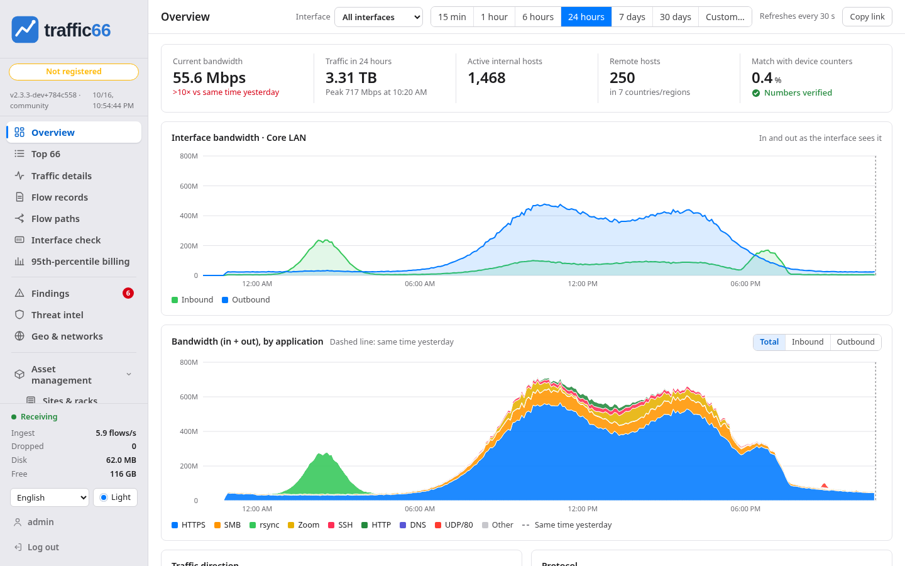

<sub>Mọi ảnh chụp màn hình đều lấy từ `traffic66 demo`, một mạng doanh nghiệp mô phỏng.</sub>

<a id="contents"></a>

## Mục lục

1. [Bắt đầu nhanh](#1-quick-start)
2. [Ví dụ](#2-examples)
3. [Người dùng và mật khẩu](#3-users-and-passwords)
4. [Gửi luồng từ thiết bị](#4-send-flows-from-your-devices)
5. [Kiểm tra luồng đã về](#5-check-that-flows-arrive)
6. [Giao diện và bộ đếm](#6-interfaces-and-counters)
7. [Tên, quốc gia và danh sách mối đe dọa](#7-names-countries-and-threat-lists)
8. [Sử dụng giao diện web](#8-using-the-web-ui)
9. [Phân tích pcap ngoại tuyến, giao diện terminal, bắt gói tin cục bộ](#9-offline-pcap-terminal-ui-local-capture)
10. [Tùy chọn và dữ liệu](#10-options-and-data)
11. [Bảo mật, định cỡ, xử lý sự cố](#11-security-sizing-troubleshooting)

<a id="1-quick-start"></a>

<a id="1-try-the-demo"></a>

## 1. Bắt đầu nhanh

1. Tải gói cho hệ điều hành của bạn: [Releases](https://github.com/githubflyideas/traffic66/releases/latest): `traffic66-linux-amd64.tar.gz`, `traffic66-linux-arm64.tar.gz`, `traffic66-darwin-arm64.tar.gz`, `traffic66-darwin-amd64.tar.gz`, `traffic66-windows-amd64.zip`.
2. Giải nén rồi chạy chương trình:

```
tar xzf traffic66-linux-amd64.tar.gz
cd traffic66-linux-amd64
./traffic66
```

Windows: giải nén `traffic66-windows-amd64.zip` rồi chạy `traffic66.exe` (nhấp đúp cũng được).

macOS: trước tiên chạy `xattr -dr com.apple.quarantine .` trong thư mục đó.

Sau đó:

- Giao diện web: `http://<IP máy chủ>:8066`. Lắng nghe trên mọi card mạng.
- Đăng nhập: người dùng `admin`, mật khẩu `traffic66`. Lần đăng nhập đầu bắt buộc đặt mật khẩu mới.
- Cho thiết bị gửi về IP máy chủ: sFlow UDP 6343, NetFlow v5/v9 UDP 2055, IPFIX UDP 4739 (mọi card mạng; mỗi cổng nhận mọi giao thức).

<a id="2-examples"></a>

<a id="2-install"></a>

## 2. Ví dụ

<a id="command-cheat-sheet"></a>

### Bảng lệnh nhanh

| Việc | Lệnh |
|---|---|
| Thu sFlow 6343, NetFlow v5/v9 2055, IPFIX 4739 (mặc định) | `./traffic66` |
| Chỉ sFlow, UDP 6343 | `./traffic66 -listen sflow=:6343` |
| Chỉ NetFlow v5/v9 cổng 2055 và IPFIX cổng 4739 | `./traffic66 -listen netflow=:2055,ipfix=:4739` |
| Cổng UDP khác | `./traffic66 -listen netflow=:9995,sflow=:6344` |
| Collector chỉ trên một IP | `./traffic66 -listen sflow=10.0.0.5:6343,netflow=10.0.0.5:2055,ipfix=10.0.0.5:4739` |
| Giao diện web trên IP và cổng chỉ định | `./traffic66 -addr 10.0.0.5:8080` |
| Giao diện web chỉ trên máy này | `./traffic66 -addr 127.0.0.1:8066` |
| Giao diện web qua HTTPS | `./traffic66 -tls` |
| Thư mục dữ liệu | `./traffic66 -data /var/lib/traffic66` |
| Giữ chi tiết flow 7 ngày | `./traffic66 -retention-days 7` |
| Bộ nhớ: 20% RAM cho cơ sở dữ liệu | `./traffic66 -memory 0.20` |
| Liệt kê card mạng để bắt gói tại chỗ | `./traffic66 interfaces` |
| Bắt gói card mạng máy này (Linux) | `sudo ./traffic66 -capture eth0 -listen ""` |
| Bắt gói card mạng máy này (macOS) | `sudo ./traffic66 -capture en0 -listen ""` |
| Bắt gói card mạng máy này (Windows, cần Npcap) | `.\traffic66.exe -capture Wi-Fi -listen ""` |
| Đặt hoặc đặt lại mật khẩu admin (thêm -data DIR nếu dùng) | `./traffic66 passwd` |
| Đặt mật khẩu admin ngẫu nhiên và in ra | `./traffic66 passwd -generate` |
| Thêm người dùng hoặc đổi mật khẩu | `./traffic66 passwd -user alice` |
| Liệt kê người dùng | `./traffic66 passwd -list` |
| Mật khẩu chỉ cho lần chạy này (script, container) | `TRAFFIC66_PASSWORD='S3cret-pass' ./traffic66` |
| Giao diện terminal trên máy traffic66 | `./traffic66 tui` |
| Giao diện terminal tới máy chủ từ xa | `./traffic66 tui -server http://192.0.2.50:8066 -user admin -password 'S3cret-pass'` |
| Ngôn ngữ giao diện terminal | `./traffic66 tui -lang ja` |
| Phân tích file capture | `./traffic66 capture.pcap` |
| Gửi flow thử tới collector | `./traffic66 simulate -to 192.0.2.50` |
| Demo với thiết bị mô phỏng | `./traffic66 demo` |
| Tất cả tùy chọn | `./traffic66 serve -h` |

Ngôn ngữ giao diện web: chọn ở cuối menu (không có cờ). Còn lại: `traffic66 serve -h`.

<a id="device-configuration"></a>

### Cấu hình thiết bị

`192.0.2.50` là traffic66, `192.0.2.1` là thiết bị; timeout và tỉ lệ lấy mẫu: [mục 4](#4-send-flows-from-your-devices).

```
! Cisco IOS-XE, NetFlow v9 (IPFIX: add "export-protocol ipfix" and use "transport udp 4739")
flow exporter T66
 destination 192.0.2.50
 transport udp 2055
 option sampler-table
flow monitor T66
 exporter T66
 record netflow ipv4 original-input
 cache timeout active 60
interface GigabitEthernet0/0/0
 ip flow monitor T66 input
```

```
# Huawei CloudEngine, sFlow
sflow agent ip 192.0.2.1
sflow collector 1 ip 192.0.2.50
interface 10GE1/0/1
 sflow sampling collector 1
 sflow sampling rate 4096
 sflow sampling inbound
 sflow counter collector 1
 sflow counter interval 30
```

```
# Huawei AR/NE, NetStream (NetFlow v9)
ip netstream export version 9
ip netstream export host 192.0.2.50 2055
ip netstream timeout active 1
interface GigabitEthernet0/0/1
 ip netstream inbound
 ip netstream sampler fix-packets 1000 inbound
```

```
# H3C Comware 7, sFlow
sflow agent ip 192.0.2.1
sflow collector 1 ip 192.0.2.50
interface Ten-GigabitEthernet1/0/1
 sflow sampling-rate 4096
 sflow flow collector 1
 sflow counter interval 30
 sflow counter collector 1
```

```
# Juniper EX/QFX, sFlow
set protocols sflow collector 192.0.2.50 udp-port 6343
set protocols sflow sample-rate ingress 4096
set protocols sflow interfaces ge-0/0/0

# Arista EOS, sFlow
sflow sample 4096
sflow destination 192.0.2.50
sflow run
```

```
# MikroTik RouterOS 7, NetFlow v9 (IPFIX: version=ipfix port=4739)
/ip traffic-flow set enabled=yes interfaces=all active-flow-timeout=1m
/ip traffic-flow target add dst-address=192.0.2.50 port=2055 version=9

# Linux host, softflowd
softflowd -i eth0 -n 192.0.2.50:2055 -v 9 -t maxlife=60
```

### Mở tường lửa

```
sudo firewall-cmd --permanent --add-port={6343,2055,4739}/udp --add-port=8066/tcp && sudo firewall-cmd --reload   # RHEL, Fedora
sudo ufw allow proto udp to any port 6343,2055,4739 && sudo ufw allow 8066/tcp                          # Ubuntu, Debian
New-NetFirewallRule -DisplayName traffic66 -Direction Inbound -Protocol UDP -LocalPort 6343,2055,4739 -Action Allow   # Windows
New-NetFirewallRule -DisplayName traffic66-web -Direction Inbound -Protocol TCP -LocalPort 8066 -Action Allow
```

### Giao diện web chỉ trên máy này, truy cập qua SSH

```
./traffic66 -addr 127.0.0.1:8066                 # on the server
ssh -L 8066:127.0.0.1:8066 user@192.0.2.50        # on your PC, then open http://127.0.0.1:8066
```

### Chạy như dịch vụ: Linux (systemd)

```
sudo mkdir -p /opt/traffic66 && curl -fsSL https://github.com/githubflyideas/traffic66/releases/latest/download/traffic66-linux-amd64.tar.gz | sudo tar xz -C /opt/traffic66 --strip-components=1
sudo useradd --system --no-create-home --shell /usr/sbin/nologin traffic66
sudo install -d -o traffic66 -g traffic66 /var/lib/traffic66
sudo -u traffic66 /opt/traffic66/traffic66 passwd -data /var/lib/traffic66
```

`/etc/systemd/system/traffic66.service`:

```
[Unit]
Description=traffic66 flow analytics
After=network-online.target

[Service]
User=traffic66
ExecStart=/opt/traffic66/traffic66 -data /var/lib/traffic66
Restart=on-failure
MemoryMax=2G
#AmbientCapabilities=CAP_NET_RAW CAP_NET_ADMIN   # only for local capture

[Install]
WantedBy=multi-user.target
```

```
echo 'net.core.rmem_max=16777216' | sudo tee /etc/sysctl.d/90-traffic66.conf && sudo sysctl --system
sudo systemctl daemon-reload && sudo systemctl enable --now traffic66
journalctl -u traffic66 -f
```

### Chạy như dịch vụ: Windows

```
$a = New-ScheduledTaskAction -Execute 'C:\traffic66\traffic66.exe' -Argument '-data C:\traffic66\traffic66-data'
$s = New-ScheduledTaskSettingsSet -ExecutionTimeLimit ([TimeSpan]::Zero) -RestartCount 999 -RestartInterval (New-TimeSpan -Minutes 1)
Register-ScheduledTask -TaskName traffic66 -Action $a -Trigger (New-ScheduledTaskTrigger -AtStartup) -Settings $s -User 'NT AUTHORITY\SYSTEM' -RunLevel Highest
Start-ScheduledTask -TaskName traffic66
```

### Chạy như dịch vụ: macOS

Giải nén vào `/usr/local/traffic66`, gỡ cờ quarantine, chạy `traffic66 passwd -data "/Library/Application Support/traffic66"`, rồi khởi động bằng LaunchDaemon có `ProgramArguments` là chương trình, `-data` và thư mục đó, cùng `RunAtLoad` và `KeepAlive`.

<a id="3-users-and-passwords"></a>

## 3. Người dùng và mật khẩu

Bản cài đặt mới đăng nhập bằng `admin` / `traffic66`, và lần đăng nhập đầu
tiên sẽ yêu cầu đặt mật khẩu mới trước khi hiển thị bất cứ thứ gì khác (bản
demo giữ nguyên `traffic66`). Sau đó, mục **Tài khoản** ở cuối menu dùng để
đổi mật khẩu; quản trị viên (`admin`) cũng thêm, xóa người dùng và đặt lại
mật khẩu cho họ tại đây. Đăng nhập bằng LDAP / Active Directory đang được
phát triển.

Người dùng được lưu dưới dạng hash có salt trong file `password` ở thư mục
dữ liệu. Có thể làm điều tương tự trên máy chạy traffic66 bằng một lệnh (thêm
`-data …` nếu traffic66 chạy với tùy chọn đó):

| Mục đích | Lệnh |
|---|---|
| Đổi mật khẩu của `admin` | `traffic66 passwd` |
| Thêm `alice` hoặc đổi mật khẩu của cô ấy | `traffic66 passwd -user alice` |
| Xóa `alice` | `traffic66 passwd -user alice -delete` |
| Liệt kê người dùng | `traffic66 passwd -list` |

Thay đổi có hiệu lực ngay. Ngoài việc quản lý người dùng, mọi người dùng đều
có quyền như nhau. Với script và container, `TRAFFIC66_PASSWORD=…` (hoặc `-password`) chỉ chấp nhận `-user`
với mật khẩu đó trong lần chạy đó. Nhập sai mật khẩu năm lần trong một phút
sẽ khóa địa chỉ đó trong một phút.

<a id="4-send-flows-from-your-devices"></a>

## 4. Gửi luồng từ thiết bị

`192.0.2.50` là traffic66, `192.0.2.1` là thiết bị. Đặt active timeout là 60
giây, cho thiết bị NetFlow/IPFIX xuất sampler options, và lấy mẫu **chiều vào
trên mọi giao diện** (hoặc chỉ các giao diện biên): khi đó mỗi gói tin chỉ được
tính một lần. Tỷ lệ lấy mẫu sFlow: khoảng 1:1000 cho 1 Gb/s, 1:4096 cho
10 Gb/s, 1:8192 cho 40/100 Gb/s.

Cấu hình cho Cisco, Huawei, H3C, Juniper, Arista, MikroTik và softflowd: [Ví dụ → Cấu hình thiết bị](#device-configuration).

<a id="5-check-that-flows-arrive"></a>

## 5. Kiểm tra luồng đã về

**Cài đặt** liệt kê trong vài giây mọi thiết bị đang gửi dữ liệu: giao thức,
tỷ lệ lấy mẫu, tỷ lệ mất, các giao diện được lấy mẫu, và cần sửa gì khi trạng
thái không phải màu xanh. Mất mẫu sFlow được tách thành mất trên đường truyền
(tăng `net.core.rmem_max` nếu `netstat -su` báo lỗi bộ đệm) và mẫu do chính
thiết bị bỏ.

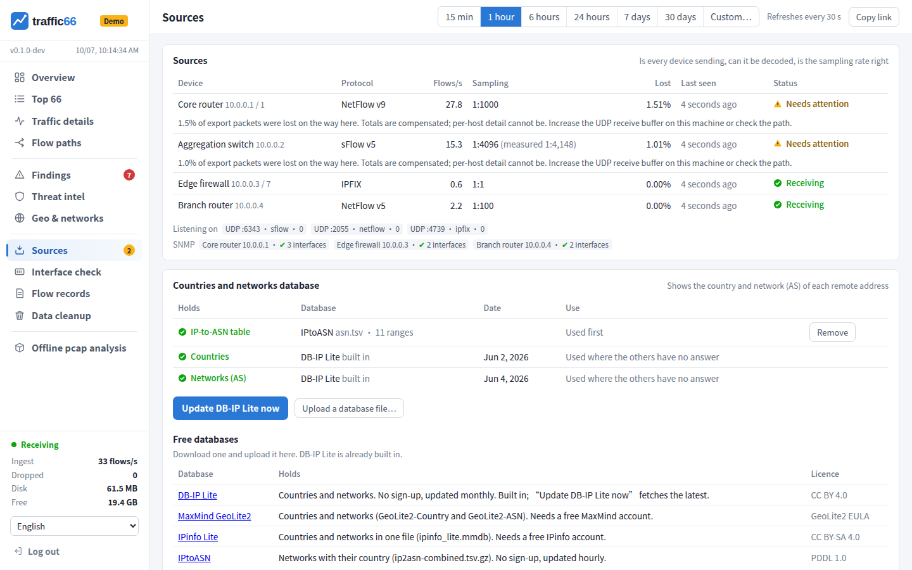

Thiếu thiết bị? Chạy `sudo tcpdump -ni any udp port 6343 or udp port 2055
or udp port 4739`: không thấy gì nghĩa là do định tuyến, tường lửa hoặc cấu
hình thiết bị; có gói tin nhưng **Cài đặt** không hiển thị gì nghĩa là do
tường lửa cục bộ hoặc `-listen`. Chạy `traffic66 simulate -to 192.0.2.50` từ
một máy khác để kiểm tra đường đi bằng thiết bị mô phỏng.

<a id="6-interfaces-and-counters"></a>

## 6. Giao diện và bộ đếm

Số liệu luồng là ước lượng (số mẫu × tỷ lệ lấy mẫu). **Kiểm tra giao diện**
so sánh chúng với bộ đếm giao diện của thiết bị (bộ đếm sFlow, hoặc SNMP qua
một dòng `snmp` trong Tên) và giải thích vì sao chênh lệch: giao diện không
được lấy mẫu, cùng một lưu lượng bị lấy mẫu hai lần, mất trên đường truyền,
hoặc không rõ tỷ lệ lấy mẫu. Mỗi giao diện có một biểu đồ bit/s và một biểu đồ
gói/s, chiều vào màu xanh lá, chiều ra màu xanh dương, bộ đếm là nét đứt.

Trên mỗi dòng, **✎** đặt tên và một nhãn ngắn (ví dụ *uplink*), còn **☆**
đặt giao diện đó làm mặc định (★), là giao diện các trang sẽ mở ra.

Thiết bị chỉ lấy mẫu một số giao diện cũng sẽ hiển thị đầu bên kia của các
luồng đó. Những **giao diện đối diện** này được liệt kê cuối cùng bằng chữ
nhỏ màu xám: chúng chỉ chứa lưu lượng đi qua giao diện được lấy mẫu. Giao diện
được lấy mẫu được xác định từ data source của sFlow hoặc trường flowDirection
(IPFIX 61); nếu không có, đó là giao diện mang 90% lưu lượng của thiết bị.

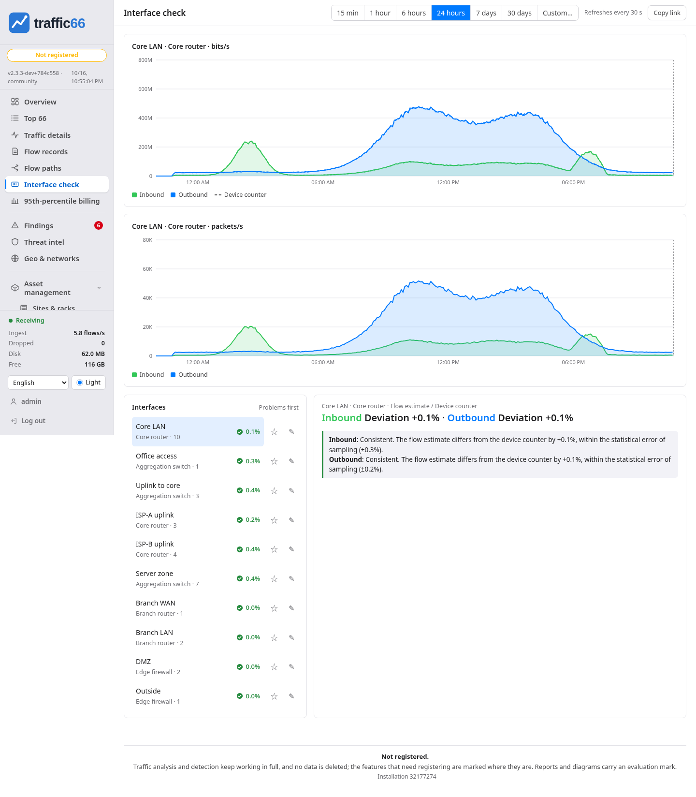

traffic66 đã tự dùng tỷ lệ mà thiết bị áp dụng, chờ khi chưa biết tỷ lệ, bù
phần mất khi xuất, rải các luồng dài ra theo từng phút, và cộng thêm 18 byte
overhead Ethernet cho mỗi gói tin với NetFlow/IPFIX (`-l2-overhead`).

<a id="7-names-countries-and-threat-lists"></a>

## 7. Tên, quốc gia và danh sách mối đe dọa

Nhấp vào bất kỳ địa chỉ nào và chọn **Đặt tên…**, hoặc dùng
**Sổ quản lý**. Tên được lưu trong `inventory.txt` ở thư mục dữ liệu:

```
net    10.10.0.0/16    Office LAN                  # your networks
net    203.0.113.0/24  Public servers country=JP    # country: lines on the world map
device 192.0.2.1       Core router
device 192.0.2.9       Branch firewall unsampled    # exports every packet
device 192.0.2.20      Edge router sampling=1000    # rate it does not declare
iface  192.0.2.1 3     ISP uplink speed=1000000000 tag=uplink default
host   10.10.3.27      Finance PC
snmp   192.0.2.1       public                       # read counters over SNMPv2c
snmp   192.0.2.9       s3cret  10.99.0.9:161        # other management address
```

Các dải địa chỉ private luôn được coi là của bạn. Thay đổi có hiệu lực khi
nhấn **Lưu**, không cần khởi động lại.

Quốc gia và mạng (AS) dùng được ngay với các cơ sở dữ liệu Lite miễn phí của
DB-IP ([CC BY 4.0](https://creativecommons.org/licenses/by/4.0/), "IP
Geolocation by DB-IP", [db-ip.com](https://db-ip.com)); **Cài đặt** dùng để
cập nhật chúng, hoặc thay bằng file MaxMind GeoLite2, IPinfo Lite hay
IPtoASN. Đường biên bản đồ: [Natural Earth](https://www.naturalearthdata.com).

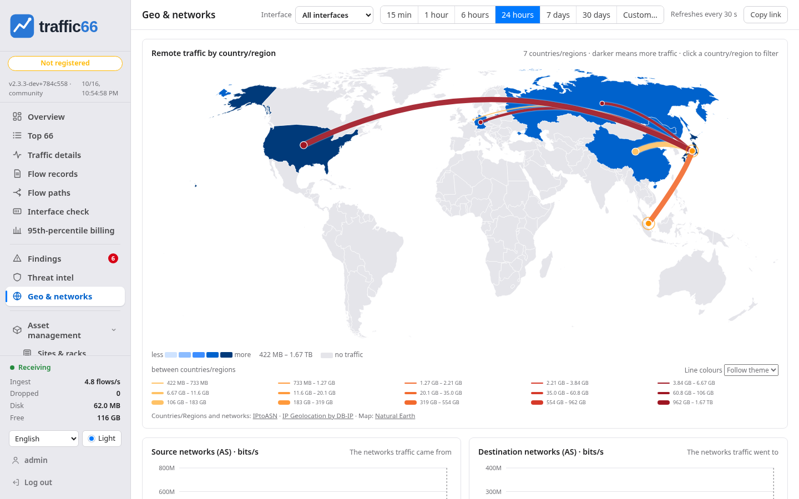

Danh sách mối đe dọa là các file văn bản, mỗi dòng một địa chỉ hoặc một dải
mạng, đặt tại `<data>/threats/<name>.txt` (ví dụ Spamhaus DROP); khởi động
lại sau khi thay đổi. Các kết quả khớp hiển thị trong **Tình báo mối đe dọa**.

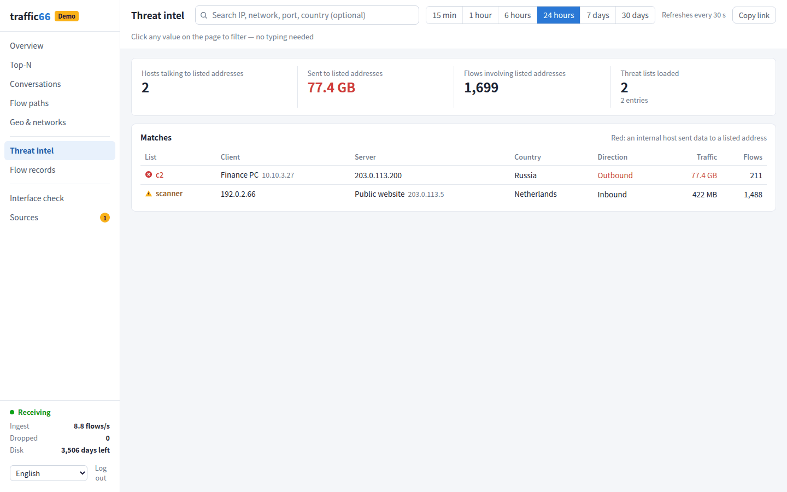

<a id="8-using-the-web-ui"></a>

## 8. Sử dụng giao diện web

Mọi giá trị trên mọi trang đều nhấp được: **Chỉ hiện mục này** / **Loại trừ
mục này** (bộ lọc áp dụng cho mọi trang), **Xem bản ghi luồng**, **Xem chi
tiết** (một trang riêng về một máy hoặc dịch vụ), **Đặt tên…**, **Tra cứu
trực tuyến**, **Sao chép**.

| Trang | Nội dung |
|---|---|
| Tổng quan | Băng thông của giao diện đang chọn; lưu lượng theo ứng dụng (tổng, chiều vào hoặc chiều ra) so với hôm qua hoặc tuần trước; các phát hiện đang mở; các client và dịch vụ hàng đầu |
| Top 66 | 66 phiên hội thoại lớn nhất, sắp xếp theo cột bất kỳ, hoặc nhóm theo ứng dụng, mạng, phân đoạn, thiết bị, kiểu đóng gói (encapsulation), VLAN; 30 máy dùng nhiều nhất |
| Chi tiết lưu lượng | Biểu đồ vòng: máy chủ và các client của chúng (hoặc ngược lại), và dịch vụ |
| Đường đi luồng | Máy → ứng dụng → quốc gia, hoặc client → dịch vụ → máy chủ, hoặc theo mạng |
| Kiểm tra giao diện | Từng giao diện theo thời gian so với bộ đếm của nó; tên, nhãn, giao diện mặc định |
| Bản ghi luồng | Từng luồng riêng lẻ, cập nhật trực tiếp mỗi 5 giây hoặc cho khoảng thời gian bất kỳ |
| Phát hiện, Tình báo mối đe dọa | Những gì cần chú ý ([bên dưới](#findings)); lưu lượng với các địa chỉ trong danh sách |
| Địa lý & mạng | Bản đồ thế giới theo quốc gia, các mạng (AS) theo thời gian |
| Cài đặt | Thiết bị, lấy mẫu, tỷ lệ mất, SNMP, cơ sở dữ liệu, logo, tên |
| Phân tích pcap offline, Dọn dữ liệu | File bắt gói tin ([bên dưới](#9-offline-pcap-terminal-ui-local-capture)); xóa dữ liệu cũ |

Phía trên các trang: **Giao diện** (tất cả, hoặc một giao diện được lấy mẫu;
khi đó các trang lưu lượng chỉ hiển thị lưu lượng đi qua giao diện đó), khoảng
thời gian (từ 15 phút đến 30 ngày, hoặc tùy chọn), làm mới mỗi 30 giây và
**Sao chép liên kết** để lưu đúng khung nhìn hiện tại. Ngôn ngữ và năm giao
diện màu nằm ở cuối menu. Biểu đồ dừng ở thời điểm dữ liệu còn đầy đủ: với
NetFlow/IPFIX là trễ bằng thời gian thiết bị xuất dữ liệu (tối đa 2 phút).
Khoảng thời gian trên 6 giờ bắt đầu từ đầu giờ chẵn; một giao diện trong 7
hoặc 30 ngày phải đọc dữ liệu luồng chi tiết, nên chậm hơn và chỉ lùi về được
đến mức dữ liệu chi tiết còn được lưu.

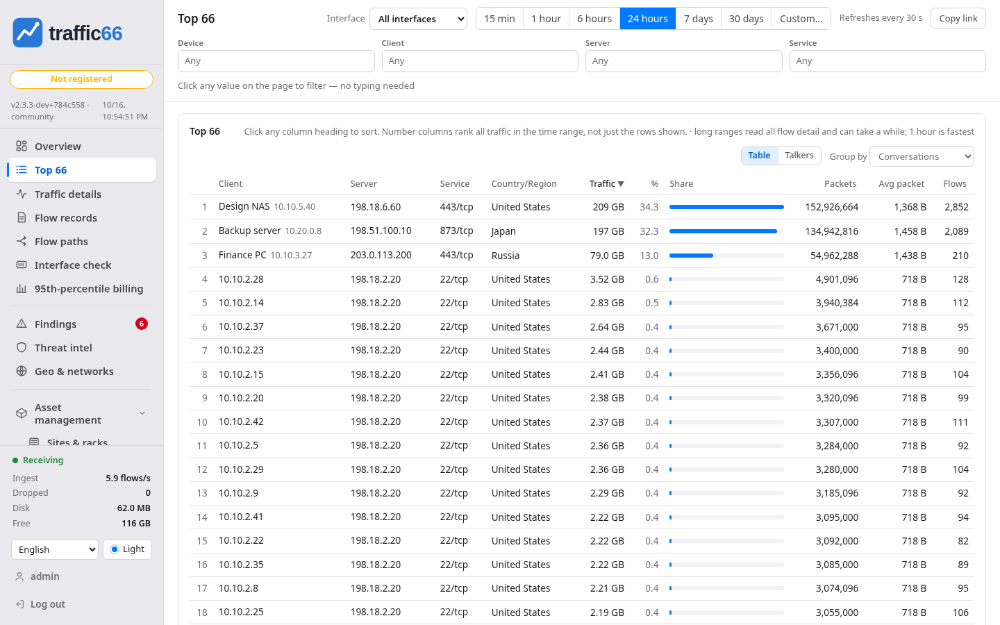

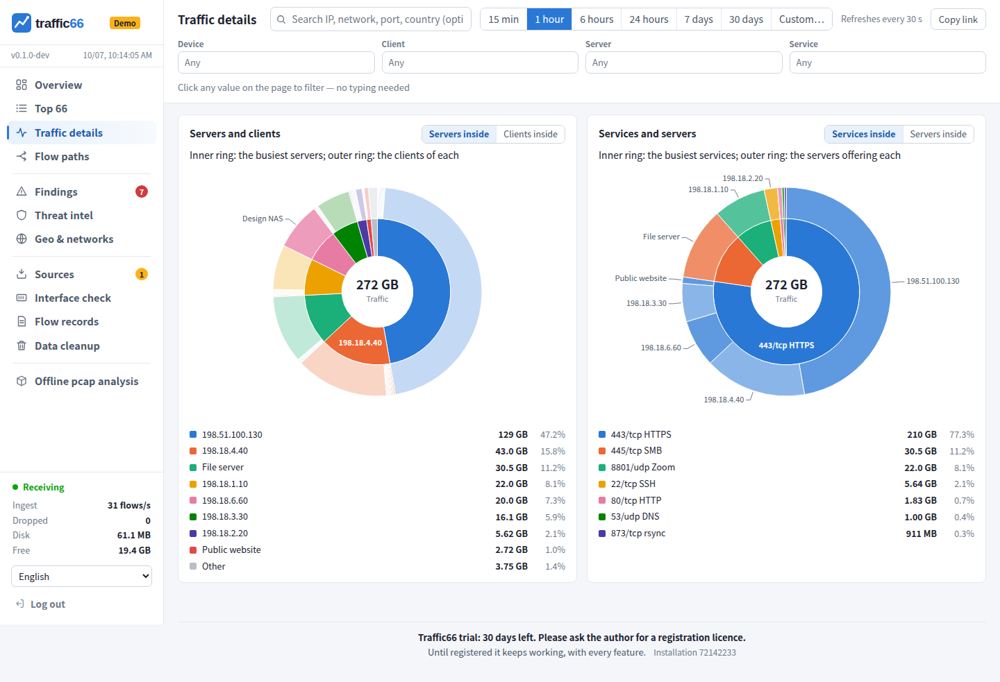

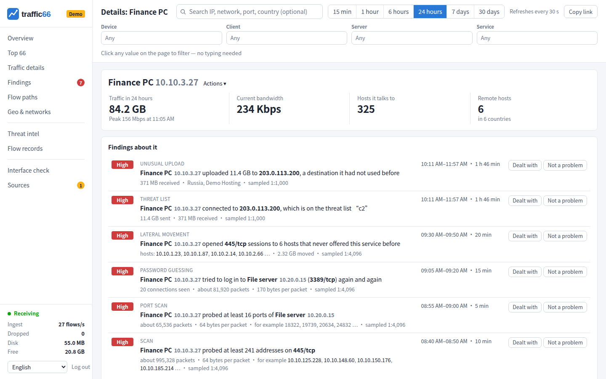

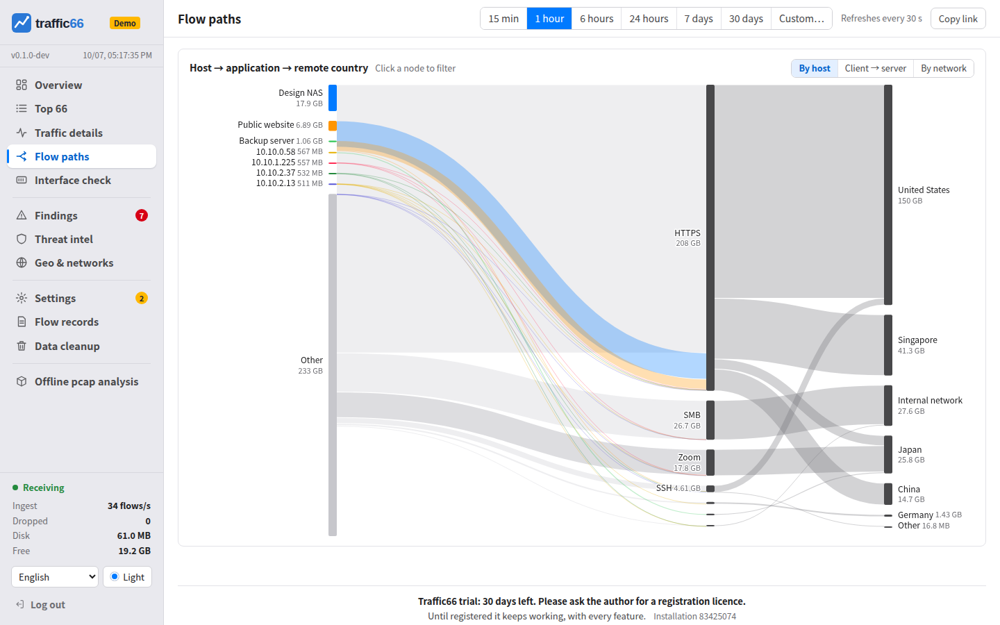

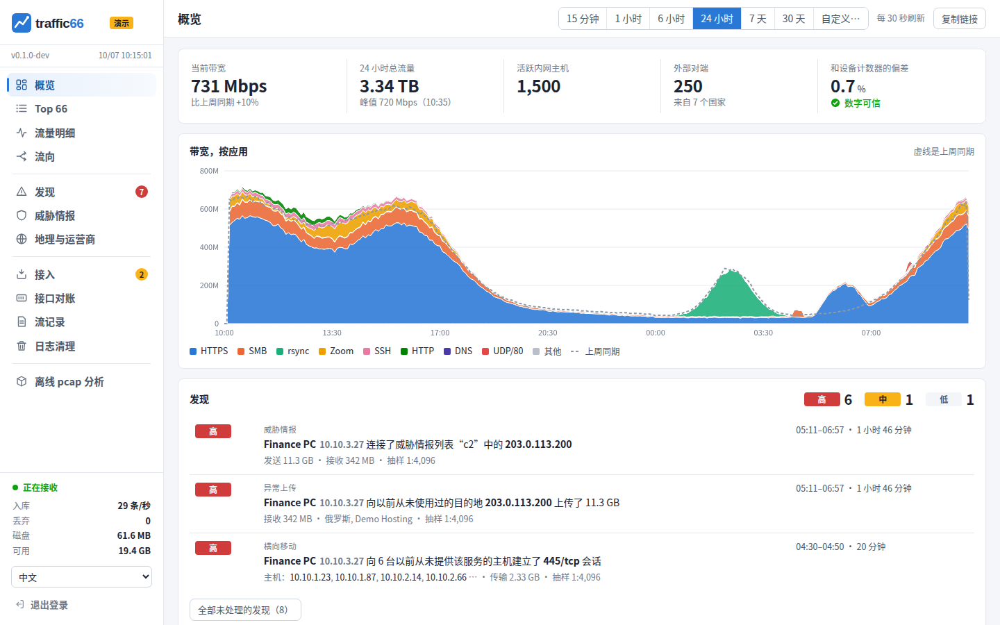

<a id="findings"></a>

### Phát hiện

Kiểm tra mỗi 5 phút trên 10 phút gần nhất; một hiện tượng kéo dài một giờ sẽ
là một phát hiện duy nhất được cập nhật dần.

| Phát hiện | Ý nghĩa |
|---|---|
| Quét mạng, quét cổng | Các gói dò nhỏ tới nhiều máy trên một cổng, hoặc tới nhiều cổng của một máy |
| Dò mật khẩu | Nhiều kết nối ngắn tới một dịch vụ đăng nhập |
| Di chuyển ngang | Chia sẻ file hoặc quản trị từ xa tới các máy nội bộ trước đây chưa từng cung cấp dịch vụ đó |
| Tải lên bất thường | 100 MB trong 10 phút tới một địa chỉ mới, gấp ba lượng dữ liệu nhận về |
| Flood | Trên 20.000 gói nhỏ/s tới một địa chỉ, gấp mười lần mức thông thường |
| Danh sách mối đe dọa | Lưu lượng với một địa chỉ trong danh sách |

Xuất phát từ bên trong mạng của bạn thì mức độ cao, từ Internet thì thấp. **Đã
xử lý** đóng một phát hiện, **Không phải sự cố** tắt hẳn phát hiện đó. Di
chuyển ngang và tải lên cần một ngày lịch sử. Với tỷ lệ lấy mẫu 1:4096, cuộc
tấn công trong bản demo vẫn được phát hiện đầy đủ; các đợt quét rất nhỏ có thể
bị lọt qua do lấy mẫu.

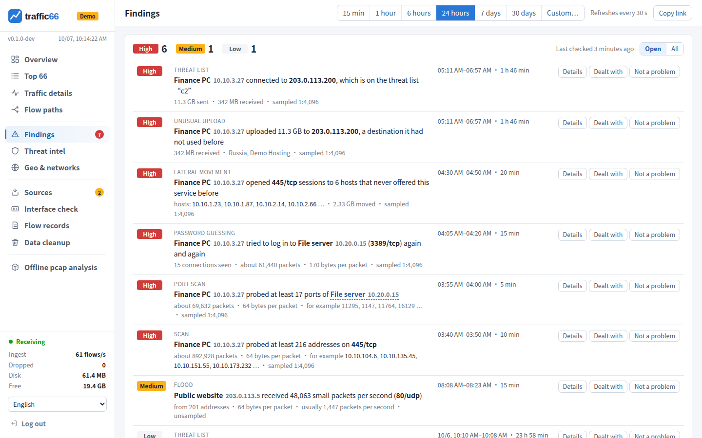

<a id="9-offline-pcap-terminal-ui-local-capture"></a>

## 9. Phân tích pcap ngoại tuyến, giao diện terminal, bắt gói tin cục bộ

**Phân tích pcap offline** hiển thị file bắt gói tin (pcap, pcapng) bằng
chính các trang trên, trừ dữ liệu trực tiếp: `traffic66 a.pcap b.pcapng` khởi
động trên 127.0.0.1 và mở trình duyệt (tối đa 3 file, 3 GB; Ctrl+C sẽ xóa dữ
liệu đã nhập), hoặc tải lên tối đa 3 file 50 MB ngay trên trang đó. Mỗi lần
chỉ phân tích một file, mỗi file trong một cơ sở dữ liệu riêng: **Phân tích**
trên dòng của một file sẽ hiển thị file đó trên mọi trang, và thanh phía trên
dùng để chuyển sang file khác. Công cụ làm việc trên luồng, không phải nội
dung gói tin.

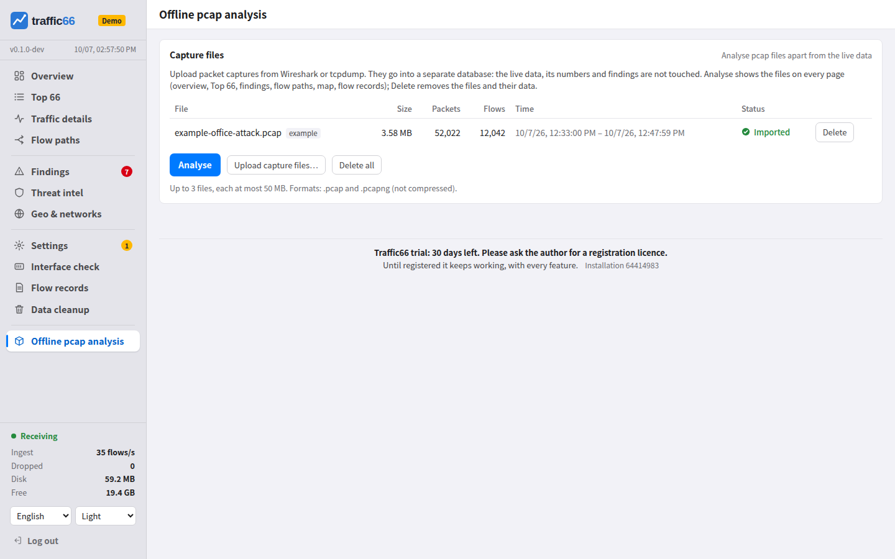

**Giao diện terminal**: `traffic66 tui` trên máy chạy traffic66, hoặc
`traffic66 tui -server http://192.0.2.50:8066 -user admin -password …`.
Ba trang: **1 Top** (máy khách, máy chủ, ứng dụng, cổng, mạng (AS) và quốc gia/vùng lãnh thổ theo tốc độ; ← → chuyển, Enter mở thao tác), **2 Giao diện** (tốc độ, mức sử dụng và đối soát theo thiết bị và giao diện, cùng tỷ lệ lấy mẫu và mất mát của từng thiết bị; Enter mở rộng xu hướng và máy/ứng dụng hàng đầu) và **3 Tìm kiếm** (bản ghi flow theo bộ lọc như `ip:10.0.0.5 net:10.0.0.0/8 asn:13335 port:443 cc:US dev:192.0.2.1`). Phím: `/` lọc, Backspace/`c` bỏ/xóa hết, `t` khoảng thời gian (5 phút đến 24 giờ), `u` bit/s, byte hoặc gói/s, `p` tạm dừng, `+`/`-` chu kỳ làm mới, `w` mở cùng chế độ xem trên trình duyệt, `?` trợ giúp, `q` thoát; `-lang` chọn ngôn ngữ, `NO_COLOR` tắt màu.

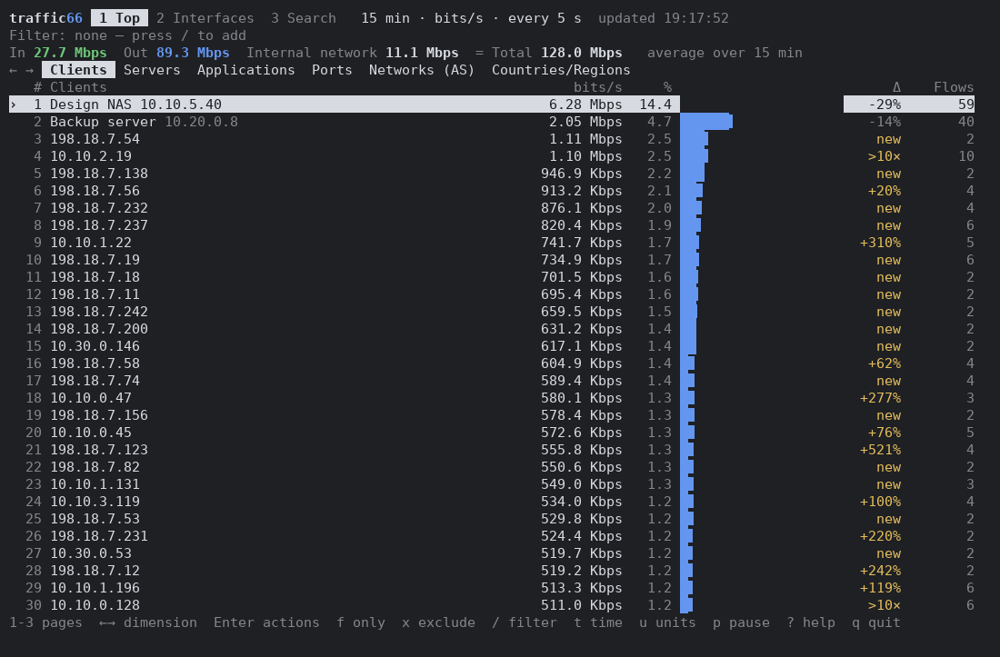

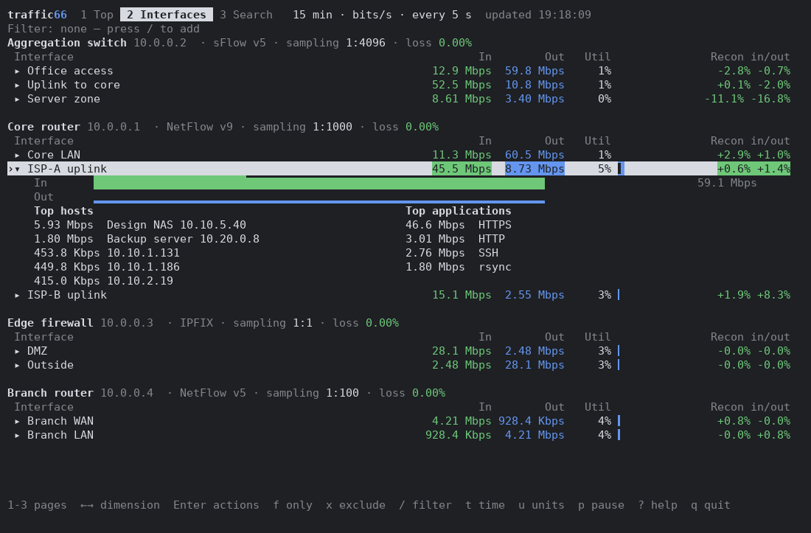

**Bắt gói tin cục bộ** dựng luồng từ một giao diện trên máy, tốt nhất là một
cổng nối với cổng mirror của switch: `traffic66 interfaces` liệt kê các giao
diện, `-capture eth1` để bắt gói. Trên Windows:

```
traffic66.exe interfaces          # list the network cards: name, number, address
traffic66.exe -capture Wi-Fi      # capture on the wireless card (or by number: -capture 2)
```

Linux cần quyền root hoặc `setcap cap_net_raw,cap_net_admin+ep`, macOS cần
root, Windows cần [Npcap](https://npcap.com). Luồng bắt được sẽ mang thiết bị
nguồn là `127.0.0.1`. Bắt gói tin cục bộ không có giao diện hay bộ đếm của
thiết bị, nên **Kiểm tra giao diện** không có gì để so sánh.

<a id="10-options-and-data"></a>

## 10. Tùy chọn và dữ liệu

`traffic66 -h` liệt kê tất cả. Các tùy chọn hay dùng nhất:

| Tùy chọn | Mặc định | |
|---|---|---|
| `-data` | `traffic66-data` cạnh chương trình | thư mục dữ liệu |
| `-addr` | `:8066` | giao diện web; `127.0.0.1:8066` để chỉ truy cập từ máy này |
| `-listen` | `sflow=:6343,netflow=:2055,ipfix=:4739` | bộ thu UDP; để trống để tắt |
| `-retention-days` | `30` | số ngày giữ dữ liệu luồng chi tiết; dữ liệu tổng hợp được giữ 400 ngày |
| `-memory` | `0.10` | tỷ lệ RAM dành cho cache cơ sở dữ liệu |
| `-sampling-wait` | `5m` | thời gian bản ghi chờ tỷ lệ lấy mẫu |
| `-capture` | | giao diện cục bộ (dùng được nhiều lần) |
| `-no-dns` | | không tra cứu ngược DNS |

Thư mục dữ liệu chứa `raw/` (dữ liệu chi tiết, mỗi giờ một file),
`traffic66.duckdb` (dữ liệu tổng hợp và bộ đếm), `password`, `inventory.txt`,
`license.json`, logo và các cơ sở dữ liệu của bạn. Sao lưu bằng cách dừng
traffic66 rồi sao chép thư mục này; nâng cấp bằng cách thay file chương trình.
**Dọn dữ liệu** xóa dữ liệu cũ hơn 7–120 ngày, hoặc xóa toàn bộ.

<a id="licence"></a>

### Giấy phép

Mã nguồn công khai theo [PolyForm Noncommercial License 1.0.0](../LICENSE.md)
và [Traffic66 Additional Use Grant](../ADDITIONAL-USE-GRANT.md) (bản tiếng Anh
có giá trị pháp lý): miễn phí để dùng thử và cho tổ chức dưới 100 người; tổ
chức lớn hơn đăng ký sau 30 ngày sử dụng thực tế; bán lại, cung cấp dịch vụ
lưu trữ cho bên khác hoặc sản phẩm cạnh tranh cần giấy phép thương mại. Không
có tính năng nào bị khóa. Cuối mỗi trang hiển thị mã cài đặt 8 chữ số; gửi mã
này cho tác giả và đặt file `license.json` nhận được vào thư mục dữ liệu. Liên
hệ: <route66traffic66@gmail.com>.

Bản cài đặt chưa đăng ký hiển thị một dải tài trợ ở đầu trang. Chỉ trình duyệt của bạn tải nó, từ GitHub ([ads-sponsor](https://github.com/githubflyideas/ads-sponsor)); máy chủ traffic66 không bao giờ kết nối GitHub cho việc này và không lưu bản sao. Trình duyệt không truy cập được GitHub sẽ hiển thị một đoạn chữ ngắn có sẵn thay thế. Không có dữ liệu nào về bạn hay bản cài đặt được gửi đi. Đăng ký sẽ gỡ nó.

<a id="11-security-sizing-troubleshooting"></a>

## 11. Bảo mật, định cỡ, xử lý sự cố

Giao diện web dùng HTTP thuần: trên mạng không tin cậy, hãy dùng
`-addr 127.0.0.1:8066` phía sau một proxy TLS (`caddy reverse-proxy --from traffic66.example.com --to
127.0.0.1:8066`) hoặc một đường hầm SSH. Chỉ cho phép các cổng UDP từ thiết bị
của bạn. Community SNMP được lưu dạng văn bản thuần; hãy dùng community chỉ
đọc.

Ở mức 5.000 luồng/s trên 2 nhân: khoảng 12 GB ổ đĩa cho mỗi ngày dữ liệu chi
tiết (360 GB cho 30 ngày), một phần sáu nhân CPU, 0,6–0,8 GB bộ nhớ. Trang tổng
quan cho khoảng thời gian dài mất dưới 0,2 giây; Top 66 trong 1 giờ trên toàn
bộ phiên hội thoại mất khoảng 9 giây.

| Triệu chứng | Cách xử lý |
|---|---|
| "đang chờ tỷ lệ lấy mẫu" | Xuất sampler options, hoặc thêm `sampling=N` / `unsampled` vào dòng device |
| Thấp hơn bộ đếm | Giao diện không được lấy mẫu, mất gói, hoặc active timeout trên 60 giây |
| Cao hơn bộ đếm | Cùng một lưu lượng bị lấy mẫu trên hai giao diện hoặc hai thiết bị |
| Quên mật khẩu | `traffic66 passwd` trên máy chạy traffic66 |
| `Conflicting lock is held` | Một tiến trình traffic66 khác đang dùng thư mục dữ liệu này |
| `address already in use` | Chọn cổng khác bằng `-addr` hoặc `-listen` |
| Windows báo "Windows đã bảo vệ PC của bạn" | **Thông tin thêm** → **Vẫn chạy** |

Biên dịch từ mã nguồn: Go 1.26 và một trình biên dịch C, sau đó chạy `CGO_ENABLED=1 go build ./cmd/traffic66`.
