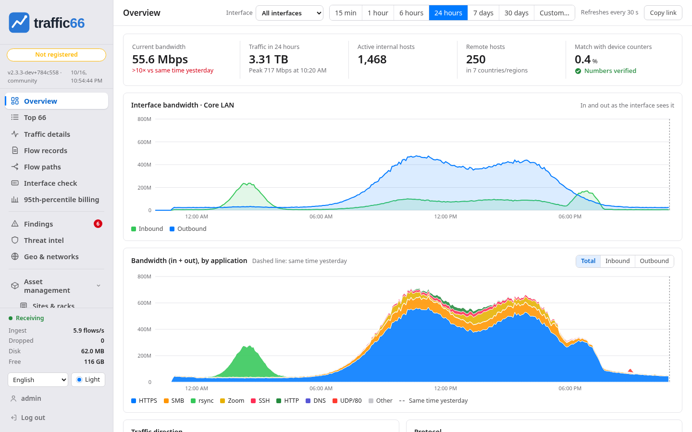
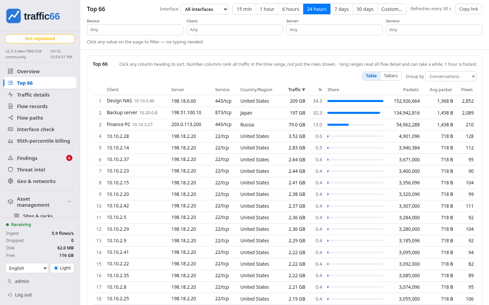
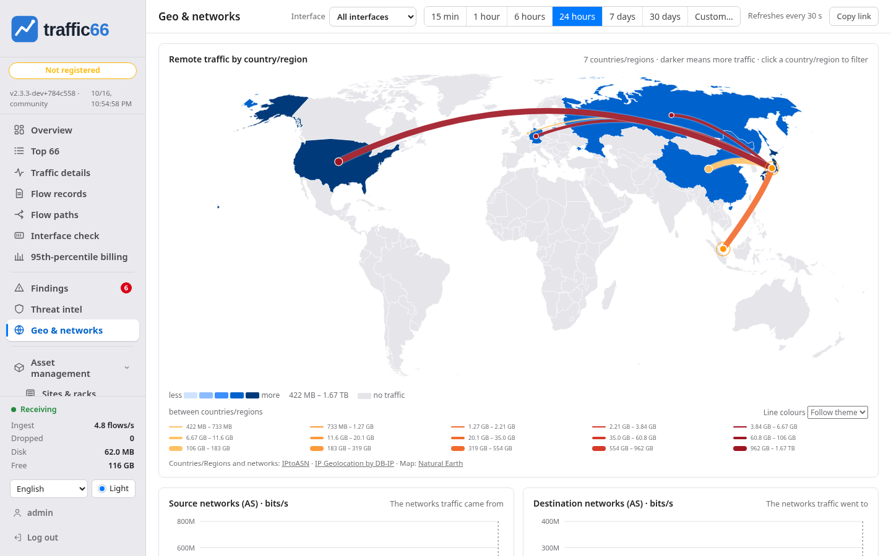
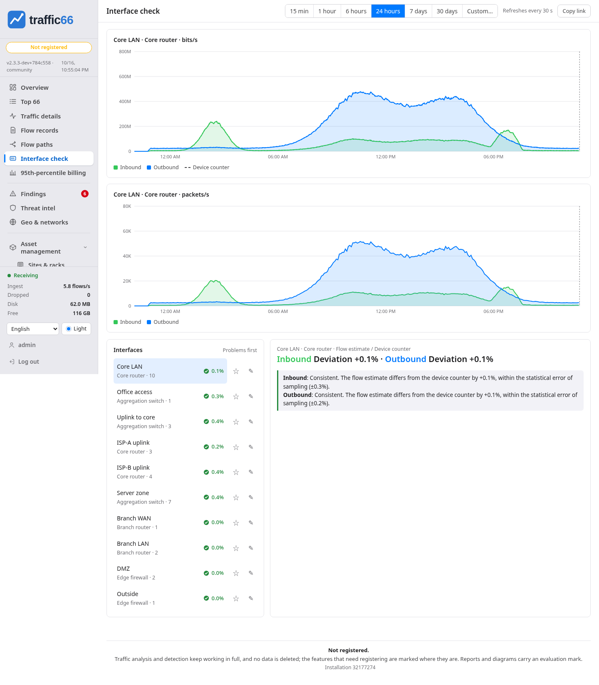
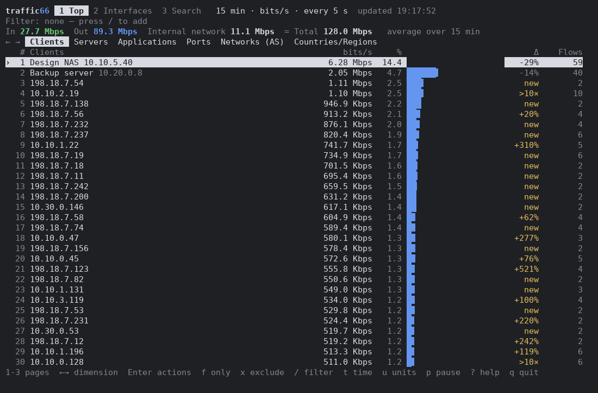

[English](../README.md) | [中文](README.zh.md) | [हिन्दी](README.hi.md) | [Español](README.es.md) | [العربية](README.ar.md) | [Français](README.fr.md) | [বাংলা](README.bn.md) | [Português](README.pt.md) | [Русский](README.ru.md) | [Bahasa Indonesia](README.id.md) | [اردو](README.ur.md) | **Deutsch** | [日本語](README.ja.md) | [Tiếng Việt](README.vi.md) | [한국어](README.ko.md)

# traffic66 — NetFlow-, sFlow- und IPFIX-Collector und Traffic-Analyzer

Flow-Analyse für sFlow, NetFlow und IPFIX in einem einzigen Programm: wer
die Bandbreite nutzt, wohin der Verkehr geht und ob die Zahlen mit den
Schnittstellenzählern der Geräte selbst übereinstimmen, in einer
Weboberfläche und einer Terminaloberfläche.

## Schnellstart

1. Archiv für Ihr System herunterladen: [Releases](https://github.com/githubflyideas/traffic66/releases/latest): `traffic66-linux-amd64.tar.gz`, `traffic66-linux-arm64.tar.gz`, `traffic66-darwin-arm64.tar.gz`, `traffic66-darwin-amd64.tar.gz`, `traffic66-windows-amd64.zip`.
2. Entpacken und das Programm starten:

```
tar xzf traffic66-linux-amd64.tar.gz
cd traffic66-linux-amd64
./traffic66
```

Windows: `traffic66-windows-amd64.zip` entpacken und `traffic66.exe` starten (Doppelklick genügt).

macOS: zuerst im Ordner `xattr -dr com.apple.quarantine .` ausführen.

Dann:

- Weboberfläche: `http://<Server-IP>:8066`. Sie lauscht auf allen Netzwerkschnittstellen.
- Anmelden: Benutzer `admin`, Passwort `traffic66`. Bei der ersten Anmeldung setzen Sie ein neues Passwort.
- Geräte an die Server-IP senden lassen: sFlow UDP 6343, NetFlow v5/v9 UDP 2055, IPFIX UDP 4739 (alle Schnittstellen; jeder Port nimmt jedes Protokoll).
- Direkt nach dem Start ist es normal, dass noch nichts zu sehen ist: Ein Gerät erscheint Sekunden nach seinem ersten Paket unter **Einstellungen**, die Diagramme folgen etwa eine Minute später. NetFlow v9/IPFIX brauchen zuerst das Template des Geräts; Datensätze eines Geräts, das seine Sampling-Rate noch nicht gemeldet hat, werden bis zu 5 Minuten zurückgehalten (`-sampling-wait`) und danach als 1:1 gezählt.
- Voraussetzungen: Programm etwa 73 MB, nichts zu installieren; Speicher im Leerlauf etwa 0,1 GB, bei 5.000 Flows/s etwa 0,6–0,8 GB, also 1 GB oder mehr einplanen. Die Weboberfläche nicht direkt ins Internet stellen: im internen Netz betreiben oder hinter einem Reverse Proxy mit HTTPS.

## Häufige Befehle

- `./traffic66`  
  Mit den Standardwerten oben starten.

- `./traffic66 -addr :9000`  
  Weboberfläche auf Port 9000 statt 8066.

- `./traffic66 -listen sflow=:6343,netflow=:9995,ipfix=:4739`  
  Collector-Ports ändern (hier NetFlow auf 9995).

- `./traffic66 -addr 192.168.1.10:8066 -listen sflow=192.168.1.10:6343,netflow=192.168.1.10:2055,ipfix=192.168.1.10:4739`  
  Nur auf einer IP-Adresse lauschen statt auf allen Schnittstellen.

- `./traffic66 -data /var/lib/traffic66`  
  Daten in einem anderen Verzeichnis ablegen (Standard: `traffic66-data` neben dem Programm).

- `./traffic66 passwd`  
  admin-Passwort setzen oder zurücksetzen (mit `-data DIR`, falls verwendet).

- `traffic66.exe interfaces`  
  Windows: Netzwerkkarten auflisten (Name und Nummer).

- `traffic66.exe -capture Wi-Fi`  
  Windows: den eigenen Verkehr dieses PCs auf der Karte analysieren (Name oder Nummer). Benötigt Npcap (npcap.com).

- `./traffic66 interfaces`  
  Linux, macOS: Netzwerkkarten auflisten.

- `sudo ./traffic66 -capture eth0`  
  Linux: eigenen Verkehr auf eth0 analysieren (macOS: `-capture en0`).

- `./traffic66 tui`  
  Terminaloberfläche auf dem traffic66-Rechner.

- `./traffic66 tui -server http://192.168.1.10:8066 -user admin -password 'your-password'`  
  Terminaloberfläche zu einem entfernten traffic66.

- `./traffic66 demo`  
  Mit simulierten Geräten ausprobieren. Der erste Start erzeugt zunächst einen Tag simulierter Historie (wenige Sekunden, auf langsamen Datenträgern länger) und öffnet dann die Weboberfläche.

## Bildschirmfotos

 

 



## Vollständiges Handbuch

In der Weboberfläche: **Hilfe** im Menü. Auf GitHub: [MANUAL.de.md](MANUAL.de.md)

15 Sprachen. Kostenlos zur Evaluierung und für Organisationen mit weniger als 100 Personen ([Lizenz](../LICENSE.md)).

- **Kostenlos**: Evaluierung, Tests und Demos für jede Organisation ohne Zeitlimit; Produktivbetrieb für Organisationen mit weniger als 100 Personen (Angestellte und Auftragnehmer) und für nichtkommerzielle Nutzung. Größere Organisationen: 30 Tage Produktivbetrieb, danach Registrierung. Details: [LICENSE.md](../LICENSE.md), [Additional Use Grant](../ADDITIONAL-USE-GRANT.md).
- **Nicht registriert**: Berichte und Diagramme tragen das Zeichen „TESTVERSION“; höchstens 3 Web-Konten.
- **Registriert**: ohne Zeichen. Kontakt: route66traffic66@gmail.com.
